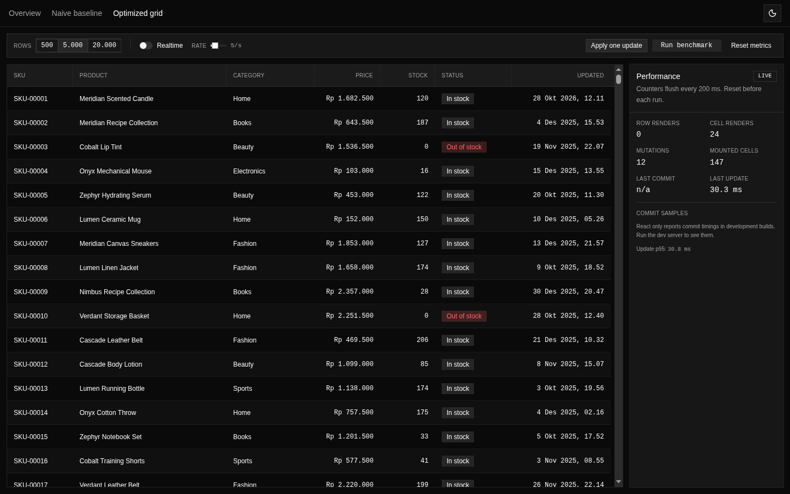
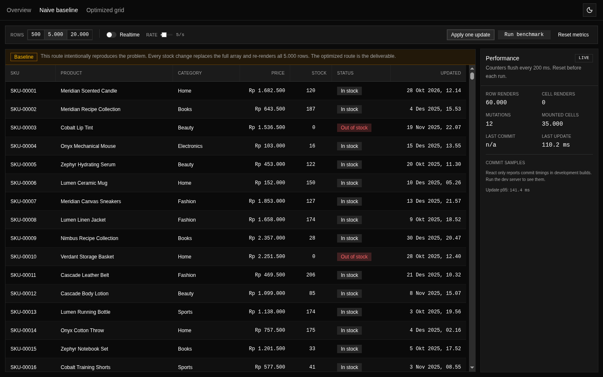
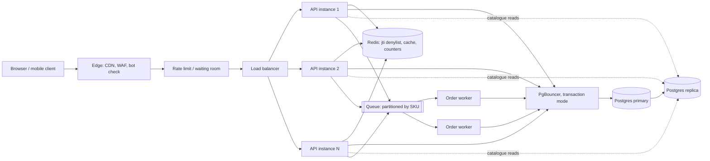
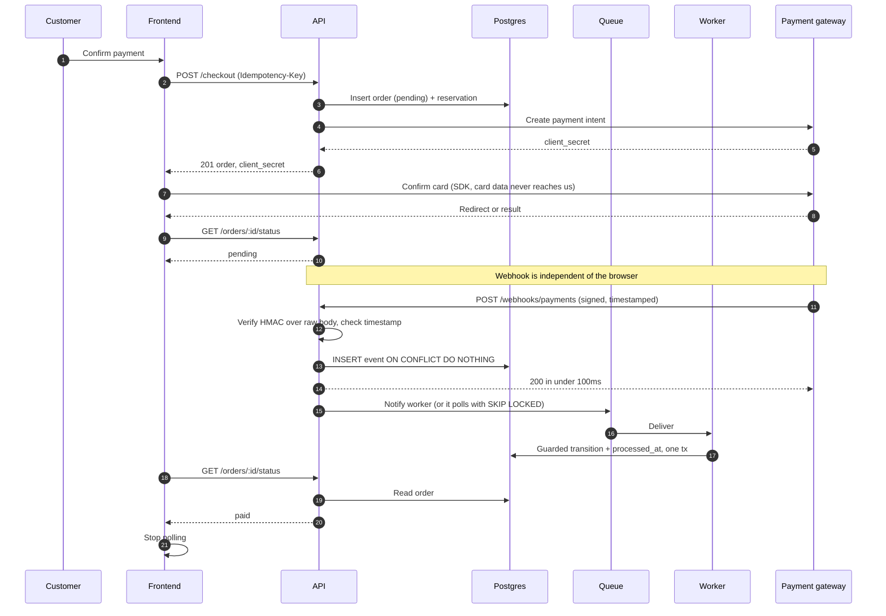

# Work Sample: Fullstack React Engineer

**Candidate:** Rahmat Hidayatullah
**Date:** 28 October 2026
**Position:** Fullstack React Engineer
**Repository:** https://github.com/erhahahaa/fullstack-work-sample-rahmat-hidayatullah

This repository contains the written answers for all five questions plus a working
implementation of question 1, and two small runnable proofs for the concurrency and
webhook questions. The answers are in English. The dashboard is a running application,
and the screenshots below come from it.

Each answer opens with a short answer in three bullets. If you only have ten minutes,
read those. The detail underneath explains the trade-offs, the failure modes, and the
measurements behind each decision.

## Contents

- [How to run](#how-to-run)
- [Stack](#stack)
- [Question 1: React Performance and State Management](#question-1-react-performance-and-state-management)
- [Question 2: Backend Architecture, JWT Authentication, and High-Concurrency Scaling](#question-2-backend-architecture-jwt-authentication-and-high-concurrency-scaling)
- [Question 3: API Integration, Webhook Reliability, and Resiliency](#question-3-api-integration-webhook-reliability-and-resiliency)
- [Question 4: Total Cost of Ownership and Monolith versus Microservices](#question-4-total-cost-of-ownership-and-monolith-versus-microservices)
- [Question 5: Feature Prioritization, Business Metrics, and Technical Debt](#question-5-feature-prioritization-business-metrics-and-technical-debt)
- [Appendix: Assumptions and References](#appendix-assumptions-and-references)

## How to run

Requirements: Bun 1.4 or newer, Node 22.12 or newer on the PATH for the Vite+
type checker. The workspace uses Bun catalogs, so `npm install` will not resolve
the dependencies.

```bash
# install Bun if it is not on the machine
curl -fsSL https://bun.sh/install | bash

bun install
bun run dev
```

| Service           | URL                   |
| ----------------- | --------------------- |
| Product dashboard | http://localhost:3001 |
| Backend demo API  | http://localhost:3002 |

The dashboard has two routes. `/naive` reproduces the original problem, a single
state object that re-renders five thousand rows on every stock change. `/optimized`
is the solution, a virtualized grid where each cell subscribes to one product. Both
routes run the same simulated real-time feed and expose the same controls, so the
comparison is fair.

Useful scripts:

| Command               | What it does                                        |
| --------------------- | --------------------------------------------------- |
| `bun run dev`         | Start the frontend and the backend together         |
| `bun run build`       | Production build for every workspace package        |
| `bun run test`        | Vitest for the frontend, `bun test` for the backend |
| `bun run check`       | Format, lint, and type checks in one pass           |
| `bun run check:fix`   | Same, with automatic fixes                          |
| `bun run check-types` | `tsc --noEmit` across the workspace                 |

Backend demos:

```bash
cd apps/backend
bun run demo:race      # 100 concurrent buyers, 1 unit in stock
bun run demo:webhook   # the same payment event delivered five times
```

## Stack

| Layer                       | Choice                                              | Why                                                                                                     |
| --------------------------- | --------------------------------------------------- | ------------------------------------------------------------------------------------------------------- |
| Runtime and package manager | Bun 1.4.3                                           | One binary for install, scripts, SQLite, and tests. The backend runs on Bun natively.                   |
| Toolchain                   | Vite+ 1.4.0                                         | Bundles Vite 8.3.5, Rolldown 1.2.15, Vitest 5.0.5, Oxlint 1.89, Oxfmt 0.74. One CLI replaces six tools. |
| Language                    | TypeScript 6.0.3                                    | Strict mode, `noUncheckedIndexedAccess` on.                                                             |
| UI                          | React 19.3.1                                        | Current stable line.                                                                                    |
| Routing                     | TanStack Router 1.170                               | File based routes with typed params and search params.                                                  |
| State                       | Zustand 5.0.16                                      | Selector subscriptions, so a single product update does not notify the tree.                            |
| Virtualization              | react-window 2.5.1                                  | v2 `Grid`. Renders only visible cells.                                                                  |
| Styling                     | Tailwind CSS 4.3 + shadcn (base-lyra)               | Accessible primitives from `@base-ui`, shared in `packages/ui`.                                         |
| API                         | Hono 4.13 on Bun                                    | Small surface, runs on `Bun.serve`, and easy to test with `app.request`.                                |
| Database                    | `bun:sqlite`                                        | Embedded, no service to install, enough to prove the atomic update and the dedupe constraint.           |
| Testing                     | Vitest 5 via `vp test`, Testing Library, `bun test` | Frontend component and store tests, backend integration tests.                                          |
| Lint and format             | Oxlint and Oxfmt via Vite+                          | One config in the root `vite.config.ts`, with per package overrides.                                    |

---

## Question 1: React Performance and State Management

**Short answer**

- The lag has three causes, not one. A single array at the dashboard root turns every stock change into a new 5,000 element array, inline props defeat `React.memo` so every row still reconciles, and 35,000 table cells make layout and paint the dominant cost.
- The fix is normalized state with per-cell subscriptions, memoized boundary components, and a virtualized grid. One update then commits two cells instead of five thousand rows.
- Measured on this machine: 85,116 DOM nodes down to 429, commit duration from 331.9 ms to 0.2 ms, and 2 cells committed per update instead of 5,000 rows. The full log is in `docs/measurements.md`.



The naive route is in the same repository at `/naive`, and the difference is visible without a profiler.



### Diagnosis in three layers

Most answers stop at "the parent re-renders". That is true but incomplete, and it leads to a fix that does not work.

**1. Re-render scope.** The naive dashboard keeps `Product[]` in one `useState` at the top of the route. A stock update runs `setProducts(previous => previous.map(...))`, which allocates a new array. React sees a new state value, re-renders the route, and every child that is not memoized re-renders with it. At 5,000 rows that is 5,000 component invocations for a change that affects one row. React 18 batches multiple state updates inside one event, but batching does not make a single commit smaller. A feed that delivers 50 updates per second can still produce 50 commits per second if each update is applied on its own.

**2. Prop identity and memoization.** Adding `React.memo` to the row is the usual next step, and on its own it often changes nothing. `onUpdate={() => update(product.id)}` creates a new function on every parent render. `style={{ padding: 8 }}` creates a new object. `React.memo` does a shallow comparison, sees a different reference, and re-renders anyway. Memoization only works when the props are stable, which means the handler has to be stable too and the style object cannot be rebuilt inline in a list of thousands.

**3. DOM size, layout, and paint.** 5,000 rows times 7 columns is 35,000 cells. With wrappers and badges, the naive route mounts 85,116 nodes. Layout, paint, hit testing, and browser memory all scale with that number. This is the part that no amount of `useMemo` can fix. Even if every row rendered in zero milliseconds, the browser still has 35,000 elements to lay out and 5,001 rows to keep in the scroll area.

The three layers need three different fixes. Memoization addresses the second, state shape addresses the first, and virtualization addresses the third.

### The baseline, measured

| Metric                                   | Naive    | Optimized |
| ---------------------------------------- | -------- | --------- |
| DOM nodes after mount                    | 85,116   | 429       |
| Cells in the DOM                         | 35,000   | 147       |
| Row component commits per single update  | 5,000    | 0         |
| Cell component commits per single update | 0        | 2         |
| Commit duration, single update           | 331.9 ms | 0.2 ms    |
| Commit p95, 20 or 100 updates            | 342.8 ms | 0.4 ms    |

The first four rows come from the production build. The commit timings come from the development build because React only calls `Profiler.onRender` in development. Both columns are compared within the same build. The method and the raw runs are in `docs/measurements.md`.

### The fix, in the order that matters

**1. Virtualize first.** This is the largest single win and it does not depend on any other change. `react-window` renders only the rows and columns that intersect the viewport. At 1440 by 900 with a 44 px row height, that is 147 cells instead of 35,000. The header is rendered once outside the grid and kept aligned with fixed column widths, so scrolling does not need to measure anything.

**2. Normalize the state.** The store keeps `byId` and `allIds` instead of an array of objects. Updating one product replaces one entry in a new map and leaves the id list untouched. The list identity is stable, which matters because the grid depends on it for `rowCount` and `rowKey`.

```ts
// apps/frontend/src/features/products/store/product-store.ts
updateMany: (updates) => {
  set((state) => {
    let changed = false;
    const byId = { ...state.byId };

    for (const update of updates) {
      const current = byId[update.id];

      if (current === undefined) {
        continue;
      }

      const next = applyStock(current, update.stock);

      if (next === current) {
        continue;
      }

      byId[update.id] = next;
      changed = true;
    }

    return changed ? { byId } : state;
  });
},
```

Two details matter here. Returning the previous state object when nothing changed means Zustand does not notify subscribers for a no-op. Keeping `allIds` out of the returned object means its reference is preserved across updates.

**3. Subscribe at the cell, not at the table.** Each cell selects one field from one product. Zustand compares the selected value and only re-renders the component when that value changes. A stock change touches the stock cell and the status cell for that product. Nothing else is notified.

```tsx
// apps/frontend/src/features/products/components/product-cell.tsx
export const ProductCell = memo(function ProductCell({ productId, column, style, align }) {
  const value = useProductStore((state) => state.byId[productId]?.[column.key]);

  return (
    <div style={style} className={...}>
      <ProductField columnKey={column.key} value={value} />
    </div>
  );
});
```

The selector returns a primitive, not an object. That is deliberate. A selector that returns `state.byId[productId]` would still work, but it returns a new reference whenever any field changes, so a price change would re-render the stock cell too. Selecting the field keeps the update surface as small as possible.

**4. Memoize the boundary and keep the props stable.** `ProductCell` is wrapped in `memo`, and the grid passes stable props from `useMemo` and `useCallback`. `react-window` v2 also memoizes `cellProps` itself, so the same object is not recreated on every render.

```tsx
// apps/frontend/src/features/products/components/product-grid.tsx
const cellProps = useMemo<GridCellProps>(() => ({ ids, columns: PRODUCT_COLUMNS }), [ids]);
const columnWidth = useCallback(
  (index: number, data: GridCellProps) => data.columns[index]?.width ?? 0,
  [],
);
const rowKey = useCallback(
  ({ data, rowIndex }: { data: GridCellProps; rowIndex: number }) => data.ids[rowIndex] ?? rowIndex,
  [],
);
<Grid<GridCellProps>
  cellComponent={GridCell}
  cellProps={cellProps}
  columnCount={PRODUCT_COLUMNS.length}
  columnWidth={columnWidth}
  rowCount={ids.length}
  rowHeight={ROW_HEIGHT}
  rowKey={rowKey}
  scrollElement={scrollElement}
  defaultHeight={600}
  onCellsRendered={handleCellsRendered}
  style={{ height: ids.length * ROW_HEIGHT, width: "100%" }}
/>;
```

`rowKey` and `columnWidth` are wrapped in `useCallback` because the library cannot memoize functions that run during render. The v2 documentation calls this out explicitly. Ignoring it produces a new key function on every render and quietly defeats the row cache.

**5. Coalesce real-time updates.** The feed buffers changes in a `Map` keyed by product id and flushes once per animation frame. If the same product changes five times before the frame lands, only the last value is applied. That converts an unbounded stream of socket messages into at most 60 state writes per second, and usually far fewer.

**6. Keep measurement out of React state.** The counters live in a module level store with a 200 ms throttle. Putting them in React state would make the profiler a source of the re-renders it is supposed to measure.

### Why memoization alone is not enough

This is the part I would push on in a review. Suppose every row is memoized correctly and the parent still maps over 5,000 items. React now performs 5,000 shallow comparisons and skips the work for unchanged rows. The commit gets faster, and on a fast laptop it may even look acceptable. But the DOM still contains 35,000 cells, the browser still lays them out, and scrolling still stutters. The number that predicts scroll performance is mounted cells, and memoization does not move it at all.

That is why the optimized route combines all three fixes. The measurement panel exposes row renders, cell renders, mounted cells, commit time, and the update latency separately, so the effect of each change is visible rather than assumed.

### State management comparison

| Option                  | Update granularity            | Cost                                 | Fit for this screen                                          |
| ----------------------- | ----------------------------- | ------------------------------------ | ------------------------------------------------------------ |
| `useState` in the route | Whole subtree                 | Lowest to start                      | Fails at 5,000 rows, this is the bug                         |
| Context                 | Every consumer of the context | Low ceremony, high re-render cost    | Bad unless split into thousands of providers, which is worse |
| Redux Toolkit           | Selector based, fine grained  | More boilerplate, excellent devtools | Works, but the ceremony is larger than the problem           |
| Zustand                 | Selector based, fine grained  | Tiny API, no provider                | Chosen here                                                  |
| TanStack Store          | Selector based, fine grained  | Small, pairs with TanStack Router    | A reasonable alternative in this stack                       |
| TanStack Query          | Request cache, not row state  | Adds a cache layer                   | Wrong tool for 50 updates per second of the same rows        |

The deciding factor is subscription granularity. Any library that lets a component subscribe to one field of one entity solves the first layer. Zustand won because the API is small enough to read in one sitting, it works outside React during the feed flush, and it does not require a provider around the table. Redux Toolkit would be my pick on a larger team that already has Redux devtools in its workflow. The table is small enough that the choice is reversible, which is itself a reason not to over-engineer it.

### A note on react-window v2

The brief shows a v1 snippet with `FixedSizeList`. That API is still available in v1 but v2 is the current release and it changed shape:

- The component is `List` or `Grid`, and rows or cells come from `rowComponent` and `cellComponent` instead of children.
- Extra data goes through `rowProps` and `cellProps`, which the library memoizes for you.
- `AutoSizer` is gone. v2 measures with `ResizeObserver` and fills its parent.
- `rowKey` and `columnWidth` must be stable callbacks, otherwise the memoization is defeated.

I used `Grid` rather than `List` because this is a table with seven columns. `Grid` virtualizes rows and columns, which is the correct primitive when the row has a fixed column layout. `List` would have required rendering the columns inside a single row component and losing the per-cell subscription, which is the whole point of the exercise.

### A note on React Compiler

React Compiler reached 1.0 in October 2025 and it is stable. It performs automatic memoization at build time and makes most manual `useMemo`, `useCallback`, and `React.memo` calls unnecessary for new code. It is worth adopting, and I would adopt it on a greenfield codebase.

I left it off here on purpose, for two reasons. The assessment asks for explicit understanding of hooks and memoization, and hiding that reasoning behind a compiler would make the solution harder to evaluate. More importantly, the compiler would not fix either of the two expensive layers. It cannot normalize state, and it cannot reduce the number of DOM nodes. A compiler-memoized 5,000 row table is still a 5,000 row table.

Enabling it is a small change: add `babel-plugin-react-compiler` as a dev dependency and pass it to `@vitejs/plugin-react`. I would do that after the structural work, not instead of it.

### What I would change at 50,000 rows

The current design holds up to a few tens of thousands of rows because the DOM is bounded by the viewport. The next bottlenecks are data transfer, filtering, and memory.

- Move filtering and sorting to the server and use cursor pagination. Sending 50,000 rows to the browser to filter them locally wastes bandwidth and memory.
- Keep the virtualized grid, but feed it from a windowed query cache. TanStack Query with `placeholderData` works well here.
- Use `useDeferredValue` for the search input so typing stays responsive while the filter runs.
- Keep selection state in a `Set` in a separate store. Selecting a row must not re-render the grid.
- Use uncontrolled inputs for inline editing, and commit on blur. A controlled input in a 5,000 row table causes a global update per keystroke.
- Instrument Interaction to Next Paint with `web-vitals` in production. Commit time is a developer metric, INP is what the customer feels.

### Tests

The frontend has 13 tests. The ones that matter for this question:

- `store/product-store.test.ts` checks that one update replaces one entity, that unrelated products keep their object identity, that `allIds` is referentially stable, and that a no-op update does not change the map.
- `product-cell.test.tsx` renders two cells, updates one product, and asserts that the second cell's output and render count do not change.
- `data/generate-products.test.ts` checks determinism, unique ids and SKUs, and the stock to status mapping.

Run them with `bun run test` from the repository root. The production build is `bun run build`.

---

## Question 2: Backend Architecture, JWT Authentication, and High-Concurrency Scaling

**Short answer**

- **Stack.** Keep the demo on Bun, Hono, and SQLite because it starts with one command and has no infrastructure to babysit. Production runs the same TypeScript service against Postgres through a connection pooler, with Redis for revocation and hot counters, and a queue in front of order writes. The demo is not the production topology, and I do not want anyone to read it as one.
- **Auth.** Access tokens live 10 to 15 minutes. A Redis denylist keyed by `jti` covers single-session logout, and a per-user token version covers logout everywhere and password changes. Refresh tokens are opaque database rows, rotated on use, with reuse detection.
- **Race.** One conditional `UPDATE` decides the last unit. Queue partitioning, reservation TTLs, idempotency keys, and compensation exist to keep that single row from becoming either the bottleneck or the only record of the truth.

The rest of this answer is the reasoning behind those three sentences, including the parts where the simple version breaks.

### Stack: Bun and Hono for the demo, Postgres for the truth

The demo is a Bun process running Hono, talking to SQLite through `apps/backend/src/db.ts`. That choice is about time to a working proof, not about a benchmark. Bun installs and runs TypeScript without a build step, Hono's router is small enough to read in an afternoon, and SQLite means the reviewer does not need Docker to see the flash sale guard behave. `apps/backend/src/routes/flash-sale.ts` is deliberately one file so the transaction boundary is visible.

I am not going to claim I benchmarked Bun against Node for this workload. The workload is I/O bound: parse a JWT, check Redis, run one short Postgres transaction. Runtime overhead is a rounding error next to a 2ms database round trip. So the stack decision should be defended on operability, not on raw request throughput.

Two alternatives I considered and why I did not pick them:

**Node with NestJS.** The mature choice for a team that already knows it. Nest gives you dependency injection, guards, interceptors, and a module structure that scales to fifty engineers. The cost is ceremony: a flash sale endpoint ends up spread across a controller, a service, two DTOs, and a module, and the transaction boundary becomes something you have to trace. Startup is slower and the framework's abstractions hide the two things that matter here, which are the SQL statement and the lock. I would pick Nest for a large CRUD product with many teams. I would not pick it for a service whose entire value is four hot code paths.

**Go with chi and sqlc.** The strongest option for raw concurrency and predictable memory. A goroutine per request and a compiled binary with no runtime warmup is genuinely nicer at 10k connections. The cost is iteration speed and hiring. Every DTO, validation rule, and auth middleware is hand-written, and the team paying for this code is a TypeScript team. Go becomes the right answer when the bottleneck is CPU or when connection count per box is the limiting factor. Here the bottleneck is one Postgres row, and Go does not make that row any less hot.

Bun plus Hono plus Postgres also has a boring escape hatch. If Bun's Postgres driver or runtime becomes a problem, the Hono app runs on Node with `@hono/node-server` and the same route code. That is a real option, not a rewrite. I care more about that than about a synthetic requests-per-second number.

### Production topology, and what the demo deliberately skips

The demo has one process, one SQLite file, and synchronous calls. Production has at least these moving parts:

- Two or more API instances behind a load balancer, in separate availability zones, because one instance is a single point of failure and deploys should not drop requests.
- PgBouncer in transaction pooling mode in front of Postgres. Not session mode. Session pooling pins a server connection per client, which defeats the point when you have more app connections than database connections.
- Postgres primary for writes and one or more read replicas for catalogue and order history reads.
- Redis for the JWT denylist, rate limit counters, the hot stock counter if I use one, and cached catalogue fragments.
- A queue (SQS, or Redis Streams if I want to avoid another vendor) plus workers for order placement and webhook side effects.

The connection math is the part people get wrong. Postgres `max_connections` defaults to 100, and each backend is a process with memory overhead. Ten API instances with a 20 connection pool each is 200 connections before migrations, cron jobs, or a psql session. That does not fit. PgBouncer lets 200 client connections multiplex onto, say, 25 server connections, sized around `4 × vCPU` for an I/O heavy workload. The pool size is a queueing decision: too small and requests wait in PgBouncer, too large and Postgres spends its time on context switches and lock contention.

Two consequences of transaction pooling that bite in practice. First, server-side prepared statements are per session, and transaction pooling breaks that assumption unless the driver handles it (Bun's SQL client and node-postgres both have modes for this, and PgBouncer 1.21+ supports protocol-level prepared statements). Second, session-scoped features stop working: `SET`, `LISTEN/NOTIFY`, session advisory locks, and temporary tables. Use `pg_advisory_xact_lock` if you need an advisory lock, because it releases at commit and survives pooling. This is the kind of detail that turns a working staging deploy into a production incident.

The demo also uses SQLite, which serializes writers at the file level. That makes the flash sale guard look simpler than it is: in SQLite, two concurrent writers cannot interleave the way they can in Postgres. The guard in `apps/backend/src/routes/flash-sale.ts` demonstrates the shape (decrement with a `stock >= qty` predicate and check the affected row count), but it does not prove Postgres row locking. `docs/race-conditions.sql` is where that gets proven, with real Postgres semantics.

### JWT revocation without pretending to be stateless

The brief asks for stateless JWT auth and instant revocation. Those two requirements fight. A signed token is valid until it expires, by construction. Any mechanism that can invalidate it before expiry is a lookup against shared state, which is the state you removed when you stopped using sessions. There is no clever encoding that avoids this. The honest design picks how much staleness is acceptable and where the lookup happens.

Ranked by revocation latency, cheapest first:

| Option                                                 | Revocation latency                    | Cost per request                                        | What breaks when the store is down                                           |
| ------------------------------------------------------ | ------------------------------------- | ------------------------------------------------------- | ---------------------------------------------------------------------------- |
| Short-lived access token, no revocation                | Up to the token TTL (10 to 15 min)    | One signature check, no I/O                             | Nothing, there is no store                                                   |
| Redis denylist keyed by `jti`                          | Milliseconds                          | One Redis `GET` (sub-millisecond on the same AZ)        | Either revoked tokens work again or every request fails, depending on policy |
| Per-user token version in cache                        | Cache TTL (30 to 60s)                 | One cache read, can be batched per user                 | Stale version accepts a revoked token until the cache expires                |
| Opaque refresh token with rotation and reuse detection | Immediate for refresh, TTL for access | One indexed database write per refresh, not per request | Refresh stops working, existing access tokens continue until expiry          |

The ranking is not a menu. Each row solves a different problem.

A denylist cannot express "log out all devices" without one entry per live token, and you do not have a list of live tokens unless you store them. A token version cannot revoke one stolen laptop without revoking the phone too. Refresh rotation does nothing about an access token that has already been minted. So the recommendation is a hybrid:

- Access token: JWT, 10 to 15 minutes, signed with EdDSA or RS256, carrying `sub`, `jti`, `ver`, `iat`, `exp`, and the tenant id. No roles that change often.
- Refresh token: 256 bits of randomness, stored as a SHA-256 hash in Postgres with `family_id`, `expires_at`, `used_at`, and `revoked_at`. Thirty day absolute lifetime, rotated on every use.
- Revocation for a single session: write `auth:denied:<jti>` to Redis with a TTL equal to the token's remaining lifetime plus clock skew. Nothing accumulates, because the key dies with the token.
- Revocation for everything: increment `users.token_version` in Postgres and cache it. The access token carries `ver`, and the verifier compares.
- Password change and "log out everywhere" bump the version and revoke all refresh families for the user in the same transaction.

This gives immediate logout where it matters, bounded staleness for reads, and a durable record for refresh. The access token stays short enough that a missed revocation is measured in minutes, not days.

The denylist check, in the shape I would actually write it:

```ts
// apps/backend/src/middleware/auth.ts (production shape)
// Runs after signature verification and before any handler.
const KEY = (jti: string) => `auth:denied:${jti}`;

export async function isRevoked(jti: string, exp: number): Promise<boolean> {
  try {
    // A negative result is cached in-process for 30s. This cuts Redis reads
    // by orders of magnitude and costs up to 30s of extra revocation delay.
    // That trade is deliberate: without it you are doing one network hop per
    // request and the "stateless" claim is gone in everything but name.
    const cached = localNegativeCache.get(jti);
    if (cached && cached > Date.now()) return false;

    const hit = await redis.get(KEY(jti));
    if (!hit) {
      localNegativeCache.set(jti, Date.now() + 30_000);
      return false;
    }
    return true;
  } catch (err) {
    // Fail policy is per route class, not global. See below.
    throw new RevocationStoreUnavailable(err);
  }
}

// On logout, TTL is what makes the denylist self-cleaning. If you set it to
// 24h "to be safe", every logout leaves a key behind long after the token is
// useless, and the keyspace grows with logouts rather than with live tokens.
export async function deny(jti: string, exp: number): Promise<void> {
  const ttlSeconds = Math.max(1, exp - Math.floor(Date.now() / 1000) + 60);
  await redis.set(KEY(jti), "1", "EX", ttlSeconds);
}
```

Two things in that snippet deserve their own paragraph.

**Fail-open versus fail-closed.** If Redis is unreachable, you have two bad options. Fail-open accepts every token, including one the user just revoked. Fail-closed returns 401 for everyone, which turns a cache blip into a full outage and is usually the worse business outcome. I would split by route class rather than choose globally. Reads (`GET /catalog`, `GET /orders/:id`) fail open with a short local cache and a metric. Money movement (`POST /checkout`, `POST /payments`), account changes, and every admin route fail closed. That means a stolen token can still browse a catalogue during a Redis outage, which is acceptable, and cannot spend money, which is the part that matters. Write the policy down, because the default in most HTTP middleware is whichever boolean the first author typed.

**The quiet reintroduction of state.** Checking Redis on every request means the auth path now depends on a network service being up. That is state, even if it is fast state. You have traded "sessions in Postgres" for "denylist in Redis" and gained latency predictability and TTL-based cleanup, not statelessness. The honest framing in a design review is: access tokens are self-contained for verification, and revocation is eventually consistent with a bound of `min(token TTL, negative cache TTL)`. Once you say that out loud, the design choices follow. If the product truly needs zero-lookup auth, drop the denylist and accept 10 to 15 minutes of staleness. Do not claim instant revocation and zero lookups at the same time.

### Refresh rotation is where reuse detection lives

An access token that expires in 10 minutes is fine only if the client can get a new one without asking the user to log in again. That is the refresh token's job, and it is the one credential that must be stateful.

The refresh token is 32 random bytes, base64url encoded, and only its SHA-256 hash is stored. A database dump then does not hand over live sessions. Each token belongs to a `family_id` that is created at login and survives every rotation. On use, the old row is marked `used_at` rather than deleted, because you need to recognize a token that has already been spent. Deleting it would make a stolen token look like an unknown token, and you would lose the signal that matters.

```ts
// POST /auth/refresh. One transaction, one row lock, one successor.
const hash = (t: string) => createHash("sha256").update(t).digest("hex");

export async function rotate(raw: string) {
  return sql.begin(async (tx) => {
    const [row] = await tx`
      SELECT id, user_id, family_id, used_at, replaced_by, expires_at
      FROM refresh_tokens
      WHERE token_hash = ${hash(raw)}
      FOR UPDATE`;

    if (!row) throw new Unauthorized("unknown_refresh");
    if (row.expires_at <= new Date()) throw new Unauthorized("expired");

    if (row.used_at) {
      // Same token presented twice. Usually two tabs racing, occasionally a
      // stolen token. A 10s grace window returns the successor instead of
      // logging the user out, which is the pragmatic default. Past the
      // window, assume theft and kill every token in the family.
      if (row.replaced_by && Date.now() - row.used_at.getTime() < 10_000) {
        return { userId: row.user_id, replay: true };
      }
      await tx`
        UPDATE refresh_tokens SET revoked_at = now()
        WHERE family_id = ${row.family_id} AND revoked_at IS NULL`;
      throw new Unauthorized("refresh_reuse");
    }

    const next = randomBytes(32).toString("base64url");
    const [created] = await tx`
      INSERT INTO refresh_tokens (user_id, family_id, token_hash, expires_at)
      VALUES (${row.user_id}, ${row.family_id}, ${hash(next)},
              now() + interval '30 days')
      RETURNING id`;

    await tx`
      UPDATE refresh_tokens
      SET used_at = now(), replaced_by = ${created.id}
      WHERE id = ${row.id}`;

    return { userId: row.user_id, refresh: next };
  });
}
```

The family revoke is the part that makes rotation worth the table. If an attacker steals a refresh token and uses it, the legitimate client's next refresh presents a spent token, the family dies, and both parties are forced back to login. Without reuse detection, rotation is just churn.

Two operational notes. Simultaneous refreshes from two tabs will trip the reuse path, so the client should single-flight its refresh call and the server should keep the grace window small but non-zero. And the table grows by one row per refresh per user, which is a lot of rows at scale. A nightly job deletes families whose absolute expiry has passed, not individual used rows, because deleting individual rows breaks the reuse check.

Three smaller things that cause real incidents:

**Clock skew.** Verifiers should allow 30 to 60 seconds of leeway on `exp` and reject an `iat` more than 60 seconds in the future. Without the future check, a token minted by a host with a fast clock is valid for longer than intended. Without the `exp` leeway, a 2 second NTP step logs out a slice of users. Cap the leeway at something small, and never extend a token's life to compensate.

**Key rotation.** Put a `kid` in the JWT header and publish public keys at `/.well-known/jwks.json`. Rotate by adding a new key, signing with it, and keeping the old public key available for at least the maximum token lifetime plus skew. Retiring the old key too early invalidates live tokens and looks like a random auth outage. The private key belongs in KMS or a secrets manager, never in an environment variable that ends up in a crash dump.

**Roles in the token.** A role claim is a snapshot. If an admin is demoted, the token still says admin until it expires. That is fine for a 10 minute token and unacceptable for a token that lives 24 hours. Keep coarse, rarely changing claims (`sub`, `tenant`, maybe a plan tier) in the token. Fetch authorization that can change (roles, permissions, entitlement) at the decision point, or accept the token TTL as the staleness bound and say so in the runbook.

### The last unit: 100 buyers, one row

The naive version reads stock, checks it in application code, then writes. Two requests read `stock = 1`, both pass the check, both write `stock = 0`, and both create an order. That is a lost update, and the bug is invisible in a single-user test. It is also not fixed by wrapping the read and write in a transaction, because under `READ COMMITTED` the two reads do not block each other. The check has to be part of the write, or the row has to be locked between the check and the write.

The primary answer is one statement:

```sql
-- One statement, one row lock, no window for a second writer to slip in.
-- If another transaction committed first, Postgres re-checks `stock >= $1`
-- against the new row version before deciding to update (EvalPlanQual).
-- That is why 99 losers get 0 rows instead of a negative stock count.
UPDATE inventory
SET stock = stock - $1,
    updated_at = now()
WHERE sku = $2
  AND stock >= $1;
-- Application: rowCount === 0 means sold out. Return 409. Do not retry.
```

If the order insert must succeed or fail with the decrement, wrap both in a transaction. The decrement still happens as one statement, and the order row commits with it:

```ts
// apps/backend/src/routes/flash-sale.ts, production shape
const rows = await sql.begin(async (tx) => {
  const claimed = await tx`
    UPDATE inventory
    SET stock = stock - ${qty}
    WHERE sku = ${sku} AND stock >= ${qty}
    RETURNING stock`;

  if (claimed.length === 0) {
    // Not an error state, just a lost race. Throwing rolls back nothing
    // because no row was written, and the handler maps it to 409.
    throw new SoldOut();
  }

  const inserted = await tx`
    INSERT INTO orders (sku, user_id, qty, status, idempotency_key)
    VALUES (${sku}, ${userId}, ${qty}, 'pending', ${idempotencyKey})
    ON CONFLICT (user_id, idempotency_key) DO NOTHING
    RETURNING id, status`;

  if (inserted.length === 0) {
    // A retry with the same key. Roll the decrement back by throwing, then
    // fetch and return the original order outside this transaction.
    throw new DuplicateAttempt(idempotencyKey);
  }

  return inserted;
});
```

The ordering with `ON CONFLICT` matters. The snippet above is safe because the conflict raises and rolls the decrement back. Remove that guard and a duplicate retry silently consumes a unit and returns nothing. The alternative ordering, used by the reservation function in `docs/race-conditions.sql`, is to claim the idempotency key first and decrement only when the claim is new. That is easier to reason about, and it is the one I would use when the write path grows past one statement.

How the alternatives compare, honestly:

| Approach                | Round trips    | Lock held across app logic   | Behaviour with 100 concurrent buyers                          |
| ----------------------- | -------------- | ---------------------------- | ------------------------------------------------------------- |
| Read, check, write      | 2+             | No, but no protection either | Oversells. Both writers see stock 1                           |
| Conditional `UPDATE`    | 1              | No                           | 1 winner, 99 see 0 rows. Correct                              |
| `SELECT ... FOR UPDATE` | 2              | Yes                          | Correct, but throughput depends on how long you hold the lock |
| Version column, retry   | 2+ per attempt | No                           | Correct, but ~99 retries, each a new round trip               |
| Redis `DECR` or Lua     | 1              | No                           | Fast, but not durable, and drifts from Postgres               |

`SELECT ... FOR UPDATE` is not wrong. It is the right tool when the decision needs more than the stock predicate, for example a per-user purchase limit that requires reading the user's order history. The problem is that it holds a row lock across whatever happens between the select and the update. If a payment provider call sits in that window, the lock is held for hundreds of milliseconds and the queue behind it becomes the outage. Keep the lock window to a single transaction with no network calls inside it.

Optimistic concurrency with a version column is correct and cheap when writes are spread out. Under a flash sale it is a retry storm. With 100 buyers and 1 unit, 99 read the same version, fail the compare, and retry, which is more work than the conditional update doing the comparison inside the storage engine. Use it for profile edits and catalogue metadata, not for the last unit.

Redis `DECR` is tempting because it is fast and atomic. Plain `DECR` is not safe, because it will go negative if you call it at zero. A Lua script that checks and decrements is safe per key, and is a good admission gate in front of Postgres. It is not the ledger. Redis can lose a write on failover, and then your counter and your orders disagree with no easy way to tell which is right. If I use it, it is a pre-filter that reduces Postgres load, with Postgres as the source of truth and a periodic rebuild from `initial_stock - count(paid + held)`.

Now the part most answers skip. Even with the perfect single statement, one row is one lock. At roughly 1ms of lock hold time you can do on the order of a thousand decrements per second on that row, in theory, before the queue of waiters dominates. Real transactions are longer, and 5k requests per second pointed at one SKU will spend most of their time waiting. The threshold is arithmetic, not a measurement I ran. Five changes matter below, though only the first two reduce contention on the row:

**Partition the stock.** Split 1,000 units into 10 rows of 100 (or 100 rows of 10) and pick a bucket per request, round robin or random. Contention drops by the partition count. The cost is that "sold out" becomes "sum of buckets is zero", which is a second query and a race of its own (a bucket can be empty while another has stock). It also makes release harder, because you must return the unit to the bucket it came from. I would only do this above a few hundred units per SKU.

**Partition the queue by SKU.** Hash `sku` to one of N queue partitions and let exactly one worker consume each partition. Requests for one SKU are then serialized before they touch the database, so the row lock is never contended and ordering per SKU is free. The cost is head-of-line blocking: a slow order for one SKU delays every order in that partition. With 256 partitions and a few thousand active SKUs, that is acceptable. With 4 partitions and 10,000 SKUs, it is not. SQS FIFO caps a single message group at 300 messages per second without batching, so the partition count and the batching policy are a throughput decision, not a detail.

**Reservation holds with a TTL.** Decrement at reservation time, write a row with `expires_at`, confirm on the payment webhook, and sweep expired holds back into stock. This is what makes it safe to decrement before payment, which you must do, because holding a transaction open for a three minute payment flow is not an option. The reservation row is also the natural place to hang the idempotency key and the state machine (`held`, `confirmed`, `released`, `expired`). A hold that never expires is inventory that silently disappears, so the sweeper is part of the feature, not an afterthought.

**Idempotency keys per checkout attempt.** The client generates a key, the server enforces a unique `(user_id, idempotency_key)`, and a retried request returns the original order instead of decrementing again. Without this, every mobile retry on a flaky connection is a chance to sell the same unit twice. This is separate from webhook idempotency, and both are needed.

**Compensation when payment fails.** The release must be a guarded state transition, not a blind increment: `UPDATE reservations SET status = 'released' WHERE id = $1 AND status = 'held'`, then return stock in the same statement or transaction. If the release is retried and the row is already `released`, the second attempt matches zero rows and does not add stock. A blind `stock = stock + 1` on every webhook delivery is how you end up with more inventory than you started with.

Last, the product question. Overselling and underselling are both failures, but they cost different things. Overselling means you sold 101 of 100, and someone has to be refunded or upgraded, usually the loudest customer on social media. Underselling means you sold 99 and left one on the shelf, which is lost revenue and a support ticket from the person who could not buy. For a hype drop I would bias toward underselling by holding back one or two units for payment failures and support, and make the sold-out state honest and fast. For a clearance sale where inventory cost is real, I would bias the other way. That is a business decision, and it should be written down next to the code rather than discovered during an incident.

### Scaling the flash sale

The race guard protects correctness. It does nothing for the surge of requests that arrive before the first one finishes. Those are separate problems.

**Connection pooling.** PgBouncer transaction mode, sized by arithmetic (`instances × pool_size` must stay under the server limit, with headroom for migrations and humans). Set `statement_timeout` and `idle_in_transaction_session_timeout` so a stuck transaction cannot hold a connection forever. A pool that is too large makes Postgres slower, not faster.

**Read replicas for catalogue.** Product pages, images, descriptions, and reviews are read-heavy and tolerant of a second or two of lag. Route them to a replica. Do not read stock from a replica if the user is about to buy, because replication lag turns into a phantom "in stock" click that fails at checkout. Stock checks go to the primary. Read-your-own-writes for order history also goes to the primary for a few seconds after a write, or the user sees "no orders" right after paying.

**Short-TTL caching.** Cache catalogue fragments for 30 to 60 seconds, and the stock badge for 1 to 3 seconds. A stock badge that is 2 seconds stale is fine if the checkout is authoritative. Use single-flight or a per-key lock so 5,000 simultaneous misses do not all hit Postgres at once. That stampede is a classic way to take down the database at the exact moment traffic peaks.

**Rate limiting and bot control.** Token bucket per user and per IP at the edge, for example 20 requests per second with a burst of 40 for browsing, much lower for checkout. Rate limiting alone does not stop a botnet with good IP diversity. Add device fingerprinting, a proof-of-work challenge for checkout, and a queue priority for accounts with purchase history. These are product-level defenses, and they belong in the design before the sale, not after.

**Load shedding and backpressure.** When the queue is full or p99 crosses a threshold, return 429 with `Retry-After` instead of accepting work you cannot finish. Shed the cheapest-to-lose traffic first: catalogue browsing before checkout, anonymous before authenticated. Bounded queues are the point. An unbounded in-memory queue converts a traffic spike into an out-of-memory crash, which is strictly worse than a fast rejection.

**A waiting room.** Issue a signed admission token when the user joins, then admit at a controlled rate that the backend can actually serve. The database only sees admitted users. This is the most effective control for a drop, because it turns an unbounded arrival rate into a bounded one. It is also the most visible to users, so the waiting room needs an honest position estimate and a stable connection.

### API surface

The full resource layout, versioning, pagination, error envelope, and status codes are in `docs/api-surface.md`. The short version: REST over JSON for anything a browser or a third party calls, because it caches at the CDN, debugs with curl, and needs no codegen on the client.

For internal calls, I would keep REST until there is a measured reason not to. gRPC earns its tooling cost when you have high fan-out between services, strict latency budgets, streaming, or a polyglot estate that benefits from a schema compiler. It costs you `buf`, generated code in CI, HTTP/2-aware load balancers, deadline propagation, and a browser story that needs gRPC-Web or a proxy. In a two-service system, that is overhead with no payoff. If the inventory service splits out and its p99 matters, gRPC between the API and inventory is a reasonable second step, and the browser still talks REST at the edge.

### Architecture



The request path for a purchase: the edge rejects obvious bots and enforces the rate limit, the waiting room admits a bounded number of buyers, an API instance verifies the JWT, checks the denylist, and either runs the conditional update directly or enqueues the order on the SKU partition. The worker owns the transaction and the reservation TTL. Catalogue reads never touch the primary. The replica is allowed to be stale, and the checkout path is not.

### What the local demo proves, and what it does not

`apps/backend/src/routes/flash-sale.ts` proves the shape of the guard: one statement, a `stock >= qty` predicate, and a check on the affected row count rather than on an exception. That is the part candidates usually get wrong, and it is worth seeing run.

It does not prove Postgres behaviour. SQLite serializes writers, so the demo cannot show two transactions racing on the same row. It does not prove throughput, because one process on one laptop is not a load test. It does not prove the queue, the waiting room, or the denylist, because those need Redis and a second process. The Postgres semantics are in `docs/race-conditions.sql`, which is runnable against a scratch database and includes the invariant queries I would put in CI. The gap between those two artifacts is the gap between a demo and a production system, and naming it is more useful than pretending it does not exist.

---

## Question 3: API Integration, Webhook Reliability, and Resiliency

**Short answer**

- **Ingest.** Verify the HMAC over the exact raw bytes before parsing, reject timestamps outside a 5 minute window, and write the provider event id into a table with a unique constraint in the same transaction as the state change. Return 2xx in under 100ms and do the slow work in a worker.
- **Recover.** Treat provider retries as the first line, not the plan. Add a reconciliation job that polls the gateway for orders stuck in `pending`, a dead letter queue with backoff, and a daily ledger check against the settlement report.
- **Show.** Poll from the frontend with exponential backoff and jitter, pause when the tab is hidden, and stop on a terminal state. Move to SSE when the number of concurrent waiters justifies the connection cost. WebSocket only if the client also needs to send events.

### Verify the bytes, then parse

The single most common webhook bug is verifying a signature against a re-serialized body. `JSON.parse` followed by `JSON.stringify` changes whitespace, key order, and unicode escapes, so the bytes you hash are not the bytes the provider signed. The result is a signature check that either fails for everyone or, worse, gets "fixed" by disabling it.

In Hono, read `await c.req.text()` in the route before any body parser runs, and pass that string to the verifier. `apps/backend/src/lib/hmac.ts` does the comparison with a constant-time equality check. Do not compare with `===`. String comparison short-circuits on the first differing byte, which leaks timing information about the expected digest.

The timestamp must be inside the signed payload, not just a header. If you sign only the body and read the timestamp from a separate header, an attacker can replay a captured body with a fresh timestamp and the signature still verifies. Sign `${timestamp}.${rawBody}` and check the timestamp after the signature passes. A tolerance of 300 seconds in both directions covers clock drift without giving an attacker a useful window. Reject future timestamps too, or a clock-skewed attacker gets an unbounded replay window.

Key rotation needs the same care as JWT key rotation. Keep two active secrets, verify against the current one and then the previous one, and only retire the previous secret after the maximum retry window has passed. Rotating a webhook secret with no overlap drops every event in flight, and the provider reads those failures as your endpoint being down.

The status code is part of the contract. A signature failure is a 400 and the provider should not retry it. A database timeout is a 500 and the provider must retry it. Returning 200 while the write failed is the one mistake that loses the event with no trace.

### Idempotency is a unique constraint, not a SELECT

The instinct is to check whether the event id exists, and skip if it does. That is not idempotent under concurrency:

```text
T1  SELECT 1 FROM webhook_events WHERE event_id = 'evt_123';  -- nothing
T2  SELECT 1 FROM webhook_events WHERE event_id = 'evt_123';  -- nothing
T1  INSERT INTO webhook_events ...;  -- succeeds
T2  INSERT INTO webhook_events ...;  -- unique violation, or second apply
```

Two deliveries of the same event, seconds apart, both pass the check. If the unique index is missing, both apply the state change and you ship two confirmation emails or credit a wallet twice. If the index exists, one insert fails with a constraint error, and whether that becomes a 500 (provider retries again) or a clean no-op depends on code you have to remember to write.

`INSERT ... ON CONFLICT DO NOTHING RETURNING id` collapses the check and the write into one atomic decision. Zero returned rows means someone else already owns this event, and the correct response is 200 with no side effects.

```sql
-- The dedupe record and the state change share one transaction.
-- If the insert conflicts, the whole block does nothing.
WITH inserted AS (
  INSERT INTO webhook_events (provider, event_id, event_type, raw_body, received_at)
  VALUES ($1, $2, $3, $4, now())
  ON CONFLICT (provider, event_id) DO NOTHING
  RETURNING id
)
UPDATE orders
SET status = 'paid',
    paid_at = now(),
    last_event_at = $5
WHERE id = $6
  AND status IN ('pending', 'authorized')   -- transition guard
  AND (last_event_at IS NULL OR last_event_at < $5)
  AND EXISTS (SELECT 1 FROM inserted);
```

The `EXISTS` makes the state change conditional on the insert having won, so a duplicate is a no-op rather than a second application. In practice I would put the insert and the update in one explicit transaction and check the insert's row count in application code, because the CTE form is harder to read when there are three side effects.

**Raw payload, kept.** Store the exact bytes, the signature header, and the receive time next to the dedupe row. When a payment is disputed three weeks later, the provider's dashboard shows that an event exists but not the bytes you actually received. A `bytea` column with a 90 day retention job is cheap insurance, and it makes replay after a code fix possible without asking the provider to resend. Parse into a typed shape after the row is written, so a schema change on their side cannot make the audit row unreadable.

The other half of the design is what "processed" means. There are two shapes, and they solve different problems:

**Inline, one transaction.** Verify, insert the event, apply the state change, commit, return 200. This is correct and simple, and it is what the local demo does. It works when the state change is a few indexed updates. It stops working when the handler sends email, calls the gateway, or writes to a search index, because now the transaction is held open across network calls and a provider timeout kills the whole thing.

**Record, then process.** The endpoint inserts the event with `status = 'received'` and returns 200. A worker claims the row, applies the state change, and sets `status = 'processed'` in one transaction. If the worker dies, the row is still `received` and a sweeper re-drives it. This is the production shape, and the events table doubles as the queue, which avoids the dual-write problem you get from committing to Postgres and then separately publishing to a broker (commit succeeds, publish fails, event is lost).

The version I would ship uses the table as the queue with `FOR UPDATE SKIP LOCKED`, and only adds a real broker when volume or fan-out justifies it. A `received` row older than 60 seconds is a bug, and it should page someone.

### The state machine is the second guard

Idempotency stops the same event from applying twice. It does nothing about a `payment.failed` event that arrives after `payment.succeeded`, which is a normal thing for a provider to do when a capture is retried. Without a guard, a paid order flips back to pending, the customer sees "awaiting payment" for an order they already paid, and support gets a ticket.

Every transition should be a conditional update with an explicit allowlist:

```text
pending     -> paid, cancelled, expired
authorized  -> paid, cancelled, expired
paid        -> refunded            (never back to pending)
refunded    -> (terminal)
cancelled   -> (terminal)
```

`UPDATE ... WHERE status IN (...)` means an illegal transition matches zero rows. That is not an error to retry, it is a fact to log. A late `failed` for a paid order should be recorded and ignored, not applied. If the amounts disagree, that is a reconciliation case, not a status update.

For legal but unordered events, keep the provider's event timestamp (or sequence number) on the order and only apply events newer than the last one. Do not rely on arrival order. Providers retry out of band, and two events can be in flight at once.

### The four failure modes

**The provider gives up.** Most gateways retry for 24 to 72 hours with backoff, then stop. If your endpoint was down for the whole window, the event is gone and the order sits in `pending` forever. The only fix is pulling the state from the gateway's API, which is why reconciliation exists.

**The provider retries while your handler is down.** The connection is refused or the request times out. This is the good case, because retries are designed for it. It only works if your endpoint returns 5xx on transient failure. Returning 200 with `{ok: true}` while the database write failed is the worst bug in this whole area: the provider marks the event delivered, never retries, and the failure is silent.

**The handler crashes after committing the dedupe row, before applying the state.** This is the subtle one. If the two writes are in one transaction, it cannot happen. If they are split, you have marked the event processed without processing it, and every retry is now treated as a duplicate and skipped. The fix is either one transaction or an explicit `received` state that a sweeper can find. A `processed_at` that is set before the work is done is a lie the system tells itself.

**The event arrives out of order.** Covered by the transition guard plus the monotonic timestamp. The remaining case is a refund that lands before the capture it refunds. That one needs a hold: park the refund event, apply it when the capture arrives, and alert if it is still parked after an hour.

### Retries and reconciliation

Provider retries handle transient failures. They do not handle a missed event, a bug in your handler, or a payload you rejected. Those need a second mechanism, and the mechanism should use the same idempotent apply path so it is safe to run alongside a live webhook.

| Trigger                                              | Mechanism                                                                                                | Expected recovery                                               |
| ---------------------------------------------------- | -------------------------------------------------------------------------------------------------------- | --------------------------------------------------------------- |
| Transient handler error (DB timeout, gateway 5xx)    | Requeue with exponential backoff and full jitter, 5 attempts, 1s to 10m, then DLQ                        | Under 5 minutes for the first three attempts, 30 minutes to DLQ |
| Endpoint down during provider retry window           | Provider retries on its own schedule, we return 5xx                                                      | Depends on the provider, usually minutes to a few hours         |
| Event missed entirely (provider gave up, deploy gap) | Reconciliation job polls the gateway for orders `pending` longer than 2 minutes, every 60s, batch capped | Under 5 minutes after the gateway state settles                 |
| Worker crashes mid-processing                        | Row stays `received`, sweeper re-claims with `SKIP LOCKED` after a 60s visibility timeout                | Under 1 minute                                                  |
| Poison event (bad payload, bug)                      | 5 attempts, then `status = 'failed'` in the events table, alert, manual replay                           | On-call dependent, target 30 minutes                            |
| Provider outage                                      | Circuit breaker on gateway calls, keep orders `pending`, do not mark failed                              | When the provider recovers, then reconciliation catches up      |
| Ledger drift (charged but no paid order)             | Daily reconciliation against the settlement report at 02:00 UTC                                          | T+1, alert if delta is non-zero                                 |

Backoff should be full jitter, not a fixed schedule: `sleep = random(0, min(cap, base * 2^attempt))`. Without jitter, every failed event retries at the same second and you rebuild the spike that caused the failure. Without a cap, the tail latency of recovery becomes hours.

Alerting is part of the mechanism, not a nice-to-have. Four signals: DLQ depth greater than zero for 5 minutes, count of orders `pending` longer than 10 minutes, webhook 5xx rate above 1% over 5 minutes, and reconciliation delta non-zero. The first two catch the failures that retries cannot. The last one catches the failures you did not model.

The daily ledger check is the backstop that does not care about your code. Sum captured payments from the provider's settlement report, sum paid orders from your database, and compare per day and per currency. A non-zero delta means either a webhook path or a refund path is broken, and it is the only check that will catch a bug that silently drops one event type.

### Telling the frontend

The browser cannot be trusted to report payment success, and it should not be the source of truth. The gateway's SDK confirms the card, then the webhook updates the order. The frontend's job is to display a state it does not own, which means it has to ask.

| Criterion           | Polling                                     | SSE                                                               | WebSocket                                                                |
| ------------------- | ------------------------------------------- | ----------------------------------------------------------------- | ------------------------------------------------------------------------ |
| Direction           | One-way (client pulls)                      | One-way (server pushes)                                           | Two-way                                                                  |
| Infra cost          | None beyond the API                         | Long-lived connections, fan-out via pub/sub, tuned proxies        | Long-lived connections plus upgrade handling, sticky sessions or pub/sub |
| Reconnect           | Trivial, next tick                          | Built in, `Last-Event-ID` resumes                                 | You write it, including resubscribe and missed-message recovery          |
| Proxies and CDNs    | Friendly                                    | Needs buffering disabled, heartbeat, HTTP/2 or a dedicated host   | Needs upgrade support end to end, often breaks at proxies                |
| Load at 10k waiters | 2,000 rps at a 5s interval, 5,000 rps at 2s | 10k idle sockets, tens of MB of buffers plus 10k file descriptors | Same as SSE, plus per-connection state and pub/sub                       |

At 10k concurrent waiters, polling every 5 seconds is 2,000 requests per second of mostly cache-miss reads. That is survivable with a small endpoint and a replica, but it is wasteful, and the latency is half the interval on average. SSE moves that to 10k idle connections. That is cheaper per update but needs a fan-out layer, a proxy that does not buffer, and a heartbeat every 15 to 30 seconds so idle connections are not reaped.

I would ship polling first. It has no infrastructure, it survives deploys, and it is easy to reason about during an incident. Adaptive backoff (1s, 2s, 4s, up to 30s) with jitter handles a gateway that is slow to settle, and a terminal-state check stops the loop. Move to SSE when sustained waiters cross a few thousand, because that is when the request rate becomes the problem rather than the latency. Use WebSocket only when the client also needs to send events, for example a live auction or a support chat. Using WebSocket for one-way status is paying the full bidirectional cost for a unidirectional problem.

Three details that matter more than the transport choice:

**Pause when hidden.** A background tab polling every second for ten minutes is pure waste, and mobile browsers throttle timers anyway, so the requests arrive in bursts when the tab wakes. Listen to `visibilitychange`, clear the timer when hidden, and fire an immediate fetch when visible again. On visible, reset the backoff to the first interval, because the user is now looking at the screen.

**One subscription per page.** If the order status component, the header badge, and the toast each run their own poller, one order generates three times the requests and three race conditions on render. Put the subscription in a context or a module-level store keyed by order id, refcount the subscribers, and tear down when the last one unmounts.

**Stop on terminal state.** `paid`, `failed`, `refunded`, and `cancelled` are terminal. Keep polling and you generate load forever for an order that will never change. Add a hard stop after 15 minutes with a "still processing, we will email you" state, so a stuck order does not poll until the tab closes.

A hook sketch that gets the important parts right:

```tsx
import { useEffect, useState } from "react";

type PaymentStatus = "pending" | "paid" | "failed" | "refunded" | "cancelled";
const TERMINAL = new Set<PaymentStatus>(["paid", "failed", "refunded", "cancelled"]);

export function usePaymentStatus(orderId: string) {
  const [status, setStatus] = useState<PaymentStatus>("pending");

  useEffect(() => {
    let cancelled = false;
    let timer: number | undefined;
    let delay = 1_000;

    async function poll() {
      if (document.visibilityState === "hidden") return;
      try {
        const res = await fetch(`/api/orders/${orderId}/status`, {
          cache: "no-store",
        });
        if (!res.ok) throw new Error(`status ${res.status}`);
        const body = (await res.json()) as { status: PaymentStatus };
        if (cancelled) return;
        setStatus(body.status);
        if (TERMINAL.has(body.status)) return; // stop for good
      } catch {
        // Network blip or 5xx. Fall through to the backoff below.
      }
      delay = Math.min(delay * 2, 30_000);
      const wait = delay / 2 + Math.random() * (delay / 2); // jitter
      timer = window.setTimeout(poll, wait);
    }

    function onVisible() {
      if (document.visibilityState !== "visible") return;
      window.clearTimeout(timer); // avoid two timers after a tab wake
      delay = 1_000;
      void poll();
    }

    void poll();
    document.addEventListener("visibilitychange", onVisible);
    return () => {
      cancelled = true;
      window.clearTimeout(timer);
      document.removeEventListener("visibilitychange", onVisible);
    };
  }, [orderId]);

  return status;
}
```

This hook runs one poller per component. The shared-subscription requirement is a wrapper around it, not a change to the backoff logic.

### Sequence



The ordering in that diagram is deliberate. The webhook is acknowledged before the state change is applied, so the response time does not depend on the worker. The queue notification is a convenience, not the source of truth. If it is lost, the committed `received` row is still there and the sweeper finds it. That is why the events table is a better queue than a separate publish: a crash between commit and enqueue leaves work to recover, instead of a committed event nobody will ever process.

### The local demo and the production gap

`apps/backend/src/routes/webhooks.ts` implements the three parts that are easy to get wrong: HMAC verification over the raw body through `apps/backend/src/lib/hmac.ts`, dedupe by provider event id, and a guarded transition so a paid order cannot move back to pending. `apps/backend/src/db.ts` keeps it on SQLite so the demo runs without services.

That is enough to show the logic and not enough to prove the system. SQLite serializes writers, so the demo cannot exhibit two workers racing on the same event. The demo applies the state change in process, so there is no queue, no visibility timeout, and no sweeper. There is no real gateway, so signature verification is tested against a locally generated secret rather than a provider's rotation schedule.

Production replaces SQLite with Postgres, moves the apply step into a worker that claims rows with `SKIP LOCKED`, and adds the reconciliation job and the ledger check. The verification and guard code survives that move almost unchanged, which is the point of keeping it in its own module. The parts that do not survive are the in-process call and the assumption that a write either happens or throws.

---

## Question 4: Total Cost of Ownership and Monolith versus Microservices

### Short answer

The migration is not financially sensible at the current scale. The AWS bill would rise from roughly 150 USD to roughly 606 USD per month, but the engineering bill rises from about 1,875 USD to about 5,625 USD per month, so the real comparison is 24,300 USD versus 74,772 USD per year.
I would keep one deployable and spend the difference on module boundaries, tests, and a worker process. The modular monolith lands near 285 USD per month of infrastructure and about 25,920 USD per year all in.
Revisit the decision when the engineering organization passes roughly 15 to 25 people, or when one module has a measured scaling or compliance reason to leave. Until then, Kubernetes is a solution to a coordination problem this company does not yet have.

### The bill is the small number

A 150 USD monthly bill sounds like an obvious thing to optimize. It is not. At a blended cost of 7,500 USD per month for an engineer, one full-time person costs 50 times the entire current infrastructure bill. Any architecture decision that consumes even a quarter of an engineer's attention is already more expensive than the servers it runs on.

That framing changes the question. The question is not "can we afford Kubernetes?" It is "what does Kubernetes let us stop spending?" For a team of five to eight engineers, the honest answer is usually "nothing measurable." The coordination pain that microservices solve arrives later, when several teams contend for one release pipeline and one database migration queue.

I have carried a pager for both shapes. The monolith pager is boring in a good way. One service, one dashboard, one deploy, one rollback. The microservices pager is interesting in a bad way at 2 a.m., when the checkout error rate is up because a retry storm in one service saturated a connection pool in another, and the trace is split across four dashboards.

### TCO at a glance

The 150 USD is probably one line on a bill. I split it here so the comparison is not rigged. This is the table I would put in front of management. The itemized sections after it show the arithmetic.

| Line item                                      |    Current monolith | Microservices on EKS, 3 AZ | Modular monolith |
| ---------------------------------------------- | ------------------: | -------------------------: | ---------------: |
| Compute, app and worker                        |               90.00 |                     147.17 |            73.59 |
| Database instance                              | included in compute |                     119.72 |            59.86 |
| Database storage and backups                   | included in compute |                      24.90 |            13.40 |
| Load balancer or reverse proxy                 |               10.00 |                      24.43 |            24.43 |
| NAT gateways and data processing               |                0.00 |                     112.05 |            37.35 |
| Kubernetes control plane                       |                0.00 |                      73.00 |             0.00 |
| Block storage and backups                      |               15.00 |                       7.20 |             4.00 |
| Public IPv4 addresses                          |                0.00 |                      14.60 |             7.30 |
| Egress and CDN                                 |               20.00 |                      27.00 |            37.00 |
| Cross-AZ transfer                              |                0.00 |                       4.00 |             0.00 |
| Image registry and secrets                     |                0.00 |                       7.00 |             3.00 |
| Logs and monitoring                            |               10.00 |                      15.00 |             5.00 |
| CI/CD                                          |                5.00 |                      30.00 |            20.00 |
| **Infrastructure subtotal**                    |          **150.00** |                 **606.07** |       **284.92** |
| Engineering operations, 0.25 / 0.75 / 0.25 FTE |            1,875.00 |                   5,625.00 |         1,875.00 |
| **Monthly total**                              |        **2,025.00** |               **6,231.07** |     **2,159.92** |
| **Annual total**                               |       **24,300.00** |              **74,772.84** |    **25,919.04** |

At 8,000 orders per month, the infrastructure and operations cost per order is 0.25 USD today, 0.78 USD on the proposed estate, and 0.27 USD on the modular monolith. That is the number the finance team should see. It connects the architecture to the P&L without pretending that the AWS bill is the whole cost.

### Current monolith, itemized

The current column is a single VM with app and Postgres co-located. The numbers are estimates from a typical provider, not AWS list prices.

| Line item                                                |   Monthly USD | Arithmetic                            |
| -------------------------------------------------------- | ------------: | ------------------------------------- |
| Single VM, 4 vCPU and 16 GB, app and Postgres co-located |         90.00 | Provider list price, estimate         |
| Block storage, 100 GB                                    |          8.00 | 100 GB at 0.08 per GB-month, estimate |
| Snapshots and object backups                             |          7.00 | 50 GB at 0.14 per GB-month, estimate  |
| Reverse proxy and TLS termination                        |         10.00 | Small managed proxy, estimate         |
| CDN and egress                                           |         20.00 | 200 GB at 0.09 plus CDN, estimate     |
| Logs and uptime monitoring                               |         10.00 | Hosted log plan, estimate             |
| CI minutes                                               |          5.00 | 2,000 minutes at 0.0025, estimate     |
| **Infrastructure total**                                 |    **150.00** |                                       |
| Engineering operations, 0.25 FTE                         |      1,875.00 | 0.25 x 7,500                          |
| **Effective monthly total**                              |  **2,025.00** |                                       |
| **Effective annual total**                               | **24,300.00** | 2,025 x 12                            |

The server is doing a lot for 150 USD. It is also a single failure domain. That is a real risk, and the modular monolith below reduces it for a fraction of the cost of a control plane.

### What the 150 USD hides

The current bill is cheap because it buys one machine and no redundancy. There is no second host, no automatic failover, and the backups may be untested. If the VM stops, the store stops. At 2,000 USD per hour of revenue at peak and 70 percent gross margin, one four-hour outage costs 5,600 USD in gross profit. That is more than four years of the difference between the current bill and the modular monolith.

This is the strongest argument for spending more, and it is not an argument for Kubernetes. A second host, a managed database with point-in-time recovery, and a tested restore cost about 285 USD per month, or 135 more than today. That is the first check I would write, before anyone says the word "microservice."

### Proposed microservices estate, priced line by line

Three availability zones, one EKS cluster, three worker nodes, one service per bounded context, Multi-AZ Postgres, and enough observability to find a broken request. This is the smallest defensible version, not the marketing version.

| Line item                                |   Monthly USD | Arithmetic                                    |
| ---------------------------------------- | ------------: | --------------------------------------------- |
| EKS control plane                        |         73.00 | 0.10 x 730 hours                              |
| Worker nodes, 3 x t4g.large, one per AZ  |        147.17 | 3 x 0.0672 x 730, estimate                    |
| Node EBS, 3 x 30 GB gp3                  |          7.20 | 90 GB x 0.08, estimate                        |
| NAT gateways, 3 AZ                       |         98.55 | 3 x 0.045 x 730                               |
| NAT data processing                      |         13.50 | 300 GB x 0.045                                |
| Application Load Balancer                |         24.43 | 0.0225 x 730 = 16.43, plus 8.00 LCU, estimate |
| RDS db.t4g.medium, Multi-AZ              |        119.72 | 0.082 x 730 x 2                               |
| RDS storage, 100 GB gp3, Multi-AZ        |         23.00 | 100 x 0.115 x 2, estimate                     |
| RDS backup storage, 20 GB over free tier |          1.90 | 20 x 0.095, estimate                          |
| Public IPv4, 3 NAT plus 1 ALB            |         14.60 | 4 x 3.65                                      |
| Internet egress                          |         27.00 | 300 GB x 0.09                                 |
| Cross-AZ transfer                        |          4.00 | 200 GB x 0.01 x 2 directions                  |
| Image registry, 20 GB                    |          2.00 | 20 x 0.10, estimate                           |
| Secrets, 10 secrets plus API calls       |          5.00 | 10 x 0.40 plus 1.00, estimate                 |
| Logs and metrics, 30 GB ingest           |         15.00 | 30 x 0.50, estimate                           |
| CI/CD runners and artifacts              |         30.00 | Estimate                                      |
| **Infrastructure total**                 |    **606.07** |                                               |
| Engineering operations, 0.75 FTE         |      5,625.00 | 0.75 x 7,500                                  |
| **Effective monthly total**              |  **6,231.07** |                                               |
| **Effective annual total**               | **74,772.84** | 6,231.07 x 12                                 |

Check the total: 73.00 + 147.17 + 7.20 + 98.55 + 13.50 + 24.43 + 119.72 + 23.00 + 1.90 + 14.60 + 27.00 + 4.00 + 2.00 + 5.00 + 15.00 + 30.00 = 606.07. Add 5,625.00 for engineering, multiply by 12.

Modular check: two app nodes at 0.0336 x 730 = 49.06, one worker at 24.53, RDS db.t4g.medium single AZ 59.86, storage 100 x 0.115 = 11.50, backups 1.90, ALB 24.43, one NAT 32.85 plus 100 GB x 0.045 = 4.50, EBS 50 x 0.08 = 4.00, two IPv4 addresses at 7.30, egress 27.00 plus CDN 10.00, registry 1.00, secrets 2.00, logs 5.00, CI 20.00. Sum 284.92. Add 1,875.00 for 0.25 FTE, multiply by 12.

This is the low end of the 500 to 900 USD range. A realistic estate with per-service load balancers, a service mesh, 500 GB of logs, and 1 TB of egress per month lands at 900 or above. The range is wide because the hidden line items are wide.

The model also gives every service one shared Multi-AZ Postgres. A database per service, which is the textbook version, adds at least 60 USD per service on db.t4g.medium, plus storage and backup work. I did not model it because most teams at this size should not run a database per service, and the shared database is one of the compromises that keeps the number defensible.

Note what is not in the table. Support plan, training, a staging cluster of the same shape, disaster recovery in a second region, and the cost of the migration itself. Those are not optional. They are just easier to defer, which is why they show up later as a surprise.

### Engineering cost dominates

The infrastructure is 9.7 percent of the microservices total. The other 90.3 percent is people. At the low end, 0.5 FTE at 6,000 USD per month, the annual cost is 43,272 USD. At the high end, 1.0 FTE at 9,000 USD per month, it is 115,272 USD. At the modeled 0.75 FTE it is 74,772 USD. Even the most favorable reading is 1.8 times the current all-in cost, and the least favorable is 4.7 times.

The modular monolith, by contrast, is 285 USD of infrastructure and 0.25 FTE of operations, or 2,160 USD per month and 25,920 USD per year. That is 135 USD per month more than today for a second host, a managed database, and backups. It buys redundancy and removes the single-host failure domain for the app. It does not buy a platform team.

The comparison that matters over three years:

| Scenario                        |  Year 1 | Year 2 | Year 3 | Three-year total |
| ------------------------------- | ------: | -----: | -----: | ---------------: |
| Current monolith                |  24,300 | 24,300 | 24,300 |           72,900 |
| Microservices, steady state     |  74,772 | 74,772 | 74,772 |          224,316 |
| Microservices with migration    | 134,772 | 74,772 | 74,772 |          284,316 |
| Modular monolith with migration |  35,920 | 25,920 | 25,920 |           87,760 |

The migration cost for microservices assumes two engineers for six months at 7,500 per month, or 90,000 USD, plus 1,800 for three months of dual running and 10,000 for training or an external review. That is 101,800, and I used 60,000 in the table as a midpoint for a smaller, less ambitious cut. The modular migration assumes six weeks of one senior engineer, about 10,000 USD, mostly spent on module boundaries and tests. Even at the midpoint, the three-year premium is about 196,000 USD over the modular monolith.

For a startup at 2 million USD ARR and 70 percent gross margin, 196,000 is 14 percent of one year's gross profit. That is not a rounding error. It is two engineers for a year, or 39 months of a 5,000 USD monthly paid acquisition budget.

The break-even argument for microservices has to clear 48,852 USD per year at steady state. That is 0.54 of an engineer at the blended rate. It is 9 percent of a six-person team and 2.7 percent of a twenty-person team. The same architecture has a different price depending on who is standing next to you.

### Hidden infrastructure costs

**EKS extended support.** Standard support for a Kubernetes version is 73 USD per month. Once the version falls out of standard support, the control plane jumps to 0.60 USD per hour, or 438 USD per month. That is an extra 365 USD per month, or 4,380 USD per year, for one forgotten upgrade. Kubernetes releases roughly every four months and each version has a support window. A team without a platform owner will drift into extended support at least once. The trap is that the bill arrives silently and the upgrade is still your work.

**NAT data processing.** The hourly charge is visible. The per-GB charge is not. At 0.045 USD per GB, 2 TB per month costs 90 USD, and 5 TB costs 225 USD. A chatty service estate moves a lot of data through NAT for package downloads, external APIs, and database connections that should have been private. A single misconfigured service that pulls a large dependency on every cold start can add hundreds per month. VPC gateway endpoints for S3 and DynamoDB are free and remove that traffic from NAT. Interface endpoints are not free, which is its own trap.

**Cross-AZ chatter.** At 0.01 USD per GB in each direction, a service mesh that sends every request across zones pays twice. 1 TB each way is 20 USD per month. That is small until it is 10 TB, which happens when a noisy service talks to a database in another zone on every request.

**Load balancers multiply.** One ALB is 16 to 30 USD per month at low traffic. Ten services each exposed as a public load balancer are ten ALBs. An ingress controller avoids this, but then the controller is another component to patch and scale.

**Observability is not free.** Thirty GB of log ingest is 15 USD at list. Real tracing and APM usually cost more than the compute. A managed APM at 30 USD per host across 10 services and 3 environments is 900 USD per month before log storage. I have seen observability exceed the compute bill in small estates. Sampling and retention are cost decisions as much as engineering decisions.

**Idle capacity.** Three AZs means three nodes minimum. At 30 to 40 percent average utilization, you pay for headroom you cannot use. That is the price of availability, and it is legitimate. It is still a cost that the 150 USD monolith does not carry.

**The staging cluster.** Most teams clone production for staging. That doubles the control plane, NAT, and database line items. If staging is a namespace in the same cluster, it is cheaper but a bad deploy can still take production with it.

### Hidden operational costs

These do not appear on the AWS bill. They appear as slower Fridays and more expensive hires.

**On-call rotation.** One service means one rotation. Ten services mean a rotation that needs a runbook per service, a service catalog, and an escalation policy that maps ownership. With five engineers, a weekly rotation is 20 percent of the year on call. With ten services, the person on call needs to know which dashboard to open for a checkout failure versus a search failure. That is training time, and it is real.

**Local development.** A monolith starts with one command and one database. A ten-service estate starts with Docker Compose, ten containers, a message broker, a mock payment provider, and 32 GB of RAM. New engineers lose one to two days before their first meaningful commit. Every contract change requires rebuilding the local topology.

**Contract drift.** Service A expects `order_id` as a string, service B starts sending an integer, and nothing fails until production. Consumer-driven contract tests catch this, but they are another pipeline, another versioning policy, and another thing to maintain. Without them, the integration test suite becomes the only place the truth lives, and it becomes slow and flaky.

**Partial failure and retries.** In a monolith, a failed function call is an exception. In a distributed system, it is an unknown state. Was the payment captured? Did the inventory decrement? You need idempotency keys, timeouts, bounded retries with jitter, circuit breakers, and a dead-letter queue. Then you need someone to drain the dead-letter queue. Retry storms are a classic second-order failure: one service slows down, callers retry, the load doubles, and the slow service falls over.

**Data consistency and sagas.** One Postgres transaction becomes a saga with compensating actions. An order is placed, payment is authorized, inventory fails, and now you need to refund and notify. The compensation logic is product logic, and it needs tests. Reconciliation jobs become a permanent part of the estate.

**Security surface.** Every service needs an identity, a network policy, a secrets path, a per-service auth policy, and a dependency scan. Ten services mean ten sets of IAM permissions and ten chances to misconfigure a public endpoint. mTLS helps, but it is another certificate rotation to own. The monolith has one attack surface with one set of controls.

**CI/CD for many deployables.** One pipeline is a morning of work. Fifteen pipelines need shared templates, caching, artifact promotion, and a version matrix. Upgrading a shared library becomes a coordinated release across services, which is exactly the coupling microservices were supposed to remove.

**Version skew.** Service A is on library version 4, service B is on version 2, and the shared contract only works on version 3. Someone has to own the upgrade calendar. In a monolith, a dependency upgrade is one pull request and one deploy.

**Slower delivery during the migration.** This is the cost nobody puts in the business case. For three to six months, the team is split between old and new, writing dual writes, backfilling data, and debugging both paths. Feature throughput drops 30 to 50 percent. If the company is trying to hit a CAC target this quarter, that is the most expensive line item of all.

### When microservices actually win

I am not against microservices. I am against paying for them before the bill is due. They win under specific conditions.

**Team size and deploy contention.** Past roughly 15 to 25 engineers across several teams, one deploy pipeline becomes a queue. Two teams want to release on the same afternoon, one team's migration blocks another team's feature, and the release manager becomes a human lock. At that point the coordination cost of the monolith exceeds the platform cost of microservices. The threshold exists because below it, one team can hold the whole system in its head, and above it, ownership boundaries start to matter more than raw infrastructure savings.

**Genuinely different scaling profiles.** Image processing needs 32 cores for two minutes. Checkout needs 2 cores all day. Running both on one host means overpaying for one and starving the other. Extract the module with the different curve, not the whole estate.

**Regulatory isolation.** Card data in scope for PCI DSS is a reason to isolate the payment path. The scope of the audit shrinks when the card data lives in one service with one network boundary. Extract payments, keep the rest.

**Independent release cadence with business value.** If pricing experiments need to ship daily and the catalog ships weekly, separate pipelines have value. The value has to be measurable in revenue or experiments per month, not in architectural purity.

**Per-service availability targets.** Payments may need 99.95 percent while recommendations can tolerate 99.5. Different SLOs justify different operational treatment. They do not justify splitting every CRUD screen into its own service.

The common thread is that each condition is an observed constraint. None of them is "we want to be cloud native." A migration without an observed constraint is a bet that the future will arrive in a specific shape. It usually does not.

### The compromise: a modular monolith

One deployable, clear internal boundaries, and the option to extract later. This is the architecture I would build at this stage.

**Shape.** A single application image contains modules for catalog, cart, checkout, payments, identity, and admin. Each module has a public entry point and a private interior. The app runs as two processes from the same image: a web process behind the load balancer and a worker process that consumes jobs. Same code, different entry point, separate scaling and failure domain.

**Database.** One managed Postgres instance with one schema per module. The catalog module owns `catalog.*`, checkout owns `checkout.*`, payments owns `payments.*`. Application code may not join across schemas. Cross-module reads go through the module's public query API or a read model. This is the boundary that makes extraction possible later, because the data is already separated by ownership even though it lives on one server.

**Hosting.** Two application containers across two hosts or one ECS service, one worker container, one ALB, one NAT gateway, one RDS instance with point-in-time recovery. Static assets go to a CDN. Images are resized at upload, not on request. That is 285 USD per month in the model above, and it fits in the 150 to 400 range with room for a staging environment.

**CI.** One pipeline: lint, typecheck, unit tests, integration tests against a Postgres service container, build, migrate, deploy. Target under 15 minutes. A deploy is one artifact and one migration. Rollback is the previous artifact plus a backward-compatible migration. This is the operational simplicity that the microservices estate gives up.

**Keeping boundaries honest.** Architecture diagrams do not enforce anything. Four mechanisms do.

1. Folder ownership. `src/modules/checkout` has a `CODEOWNERS` entry. The team that owns checkout reviews every change in that folder. Ownership is visible in the pull request, not in a wiki.
2. Import rules. Each module exposes `index.ts` and nothing else. A lint rule bans deep imports such as `../../catalog/internal/price`. `eslint-plugin-boundaries` or `dependency-cruiser` fails the build on a violation. This is the most valuable rule in the repo.
3. Contract tests at the seam. When checkout calls catalog, the call goes through a typed interface with a contract test. The test runs in CI. If catalog changes the shape, checkout fails before production.
4. Schema ownership. Migrations are grouped by module and reviewed by the owning team. A migration that touches another module's schema is rejected. Cross-schema views are owned by the read side, not by the writer.

**Migration path.** Do not rewrite. Use a strangler approach. Start with the module that has the clearest boundary and the most change traffic, usually checkout or payments. Put an interface in front of it, add tests, move the code behind the interface, then delete the old path. Extract it into a separate deployable only when one of the decision-table signals fires. Because the module already has its own schema and public API, extraction is a move, not a rewrite.

**Cost of the compromise.** You give up independent scaling per module and independent deploys. You accept a shared blast radius and a shared release train. In exchange you keep one on-call rotation, one pipeline, one database, and roughly 49,000 USD per year compared with the microservices estate. That is a good trade at this stage.

The 285 USD model keeps Postgres in a single AZ. That is a deliberate cost choice, not an oversight. Add 73 USD per month for Multi-AZ and another 11.50 for duplicated storage when the SLA or the revenue at risk justifies it. I would add it before the first paid campaign, not after the first database failover. Even with Multi-AZ, the modular monolith is about 370 USD per month, still inside the 150 to 400 range.

### Decision table

| Signal               | Threshold                                                                          | Action                                                                    |
| -------------------- | ---------------------------------------------------------------------------------- | ------------------------------------------------------------------------- |
| Deploy contention    | More than 2 teams blocked on one pipeline, or more than 2 blocked deploys per week | Split the deployable along the module boundary that causes the contention |
| Hot module CPU       | One module consumes more than 60 percent of host CPU at p95 for 2 weeks            | Extract that module to its own service and scaling group                  |
| Team split           | Two teams own the same module and review each other's code by default              | Assign one owner or split the module, not the whole app                   |
| Compliance           | Card data or health data enters scope                                              | Isolate the regulated module first, keep the rest in the monolith         |
| Database contention  | DB CPU above 70 percent or lock waits above 100 ms at p95                          | Add a read replica, fix the query, then consider schema extraction        |
| Release cadence      | A module needs daily independent releases with measured business value             | Extract that module with contract tests and its own pipeline              |
| EKS upgrade drift    | Cluster version within 60 days of end of standard support                          | Upgrade or budget 438 USD per month, do not drift silently                |
| On-call load         | More than 2 pages per week per engineer, or MTTR above 1 hour                      | Stop feature work, fix the top failure path, revisit architecture         |
| Cloud cost per order | Up 30 percent quarter over quarter at flat volume                                  | Instrument cost per request before changing architecture                  |

### Lambda is not the cheap escape hatch

The brief mentions AWS Lambda alongside Kubernetes. Lambda is a good fit for spiky asynchronous work: image resizing, email fan-out, exports, webhook retries. It is a poor default for the core request path at this scale. The API still needs a home, the database still needs connection pooling, and the observability still needs traces across invocations.

The operational costs do not disappear. They move. Cold starts show up as p95 latency. Concurrency limits show up as throttling during a campaign. Per-invocation logging shows up as a log bill that is hard to predict. Packaging and IAM policies become a deployment concern for every function. A Lambda-based estate can be cheaper than idle nodes at low volume, but it is not cheaper than one container that is already running.

If the team wants serverless, use it at the edges. Keep the transactional core in a process you can profile and debug.

### Sensitivity: what actually moves the number

| Driver                 |                Low case |              High case | Annual delta | Comment                                 |
| ---------------------- | ----------------------: | ---------------------: | -----------: | --------------------------------------- |
| Engineering allocation |        0.5 FTE at 6,000 |       1.0 FTE at 9,000 |       72,000 | The dominant variable, not the AWS bill |
| EKS extended support   |            73 per month |          438 per month |        4,380 | One missed upgrade                      |
| NAT data processing    |        300 GB per month |         5 TB per month |        2,538 | Chatty services and package pulls       |
| Log and trace volume   |         30 GB per month |       300 GB per month |        1,620 | Retention and sampling decide this      |
| Internet egress        |        300 GB per month |         3 TB per month |        2,916 | Images and unoptimized assets           |
| Database availability  |               Single AZ |               Multi-AZ |          879 | The one line I would not cut            |
| Staging clone          | Namespace in production | Full duplicate cluster |        3,600 | Safety versus cost                      |

No single infrastructure line changes the decision. A 0.25 FTE change in engineering allocation is larger than every infrastructure surprise combined. That is why the architecture argument has to be about coordination and delivery, not about the bill.

### If management insists on the migration

I would not refuse and I would not comply silently. I would turn the migration into stage gates with exit criteria, so the company can stop after each stage without losing the work.

1. Stage 0, two weeks. Instrument cost per order, p95 latency by journey, error rate, and deploy frequency. Tag every resource by service and environment. Exit when the baseline is visible on one dashboard.
2. Stage 1, six weeks. Modularize the code, add import rules, move jobs to a worker, and consolidate to one pipeline. Exit when the build is under 15 minutes and no module imports another module's internals.
3. Stage 2, eight weeks. Extract one module, usually payments or checkout, behind a contract. Keep it in the same cluster if a cluster already exists. Exit when the extracted service has a runbook, an SLO, and a rollback that has been tested.
4. Stage 3, quarterly. Review the decision table. Extract the next module only if a signal fired. If no signal fired, stop and bank the savings.

The staged path costs one senior engineer plus about 0.5 of a platform engineer for 16 weeks. At 1.5 FTE and a blended 7,500 USD per month, that is about 45,000 USD, and it is the same work the modular monolith needs in stages 0 and 1. It is not a standing platform team. It also produces value at every stage. Stage 1 alone usually improves deploy frequency and reduces merge pain, whether or not the company ever runs Kubernetes.

### What I would do

1. Move the current app to two hosts behind a load balancer and a managed Postgres with point-in-time recovery. That removes the single-host failure domain for the app for about 285 USD per month, or 135 more than today.
2. Split the code into modules with public entry points and add the import lint rule in the same sprint. No behavior change, just a fence.
3. Move background jobs to a worker process from the same image. This is the first real scaling win and it does not require a new deployable.
4. Add a single CI pipeline with integration tests and a migration check. Measure deploy frequency and change failure rate before touching the architecture again.
5. Put a quarterly review on the calendar. At that review, look at the decision table. If no signal fires, do nothing. If one fires, extract one module.

The architecture is not the product. The product is. Every month spent on a platform the company does not need is a month not spent on the checkout conversion that pays for the platform.

### Sources and caveats

Prices are AWS list prices for us-east-1, checked in October 2026, as provided in the brief. Items marked estimate are outside that list and are modeled, not quoted. The full assumption set, including traffic, request mix, team size, salary band, database size, storage growth, logging volume, AZ count, and SLA, lives in `docs/tco-assumptions.md`. The numbers are a model for comparing shapes, not a quote from AWS or a payroll provider. A real bill will differ, and the difference will usually be in egress, logs, and idle capacity.

---

## Question 5: Feature Prioritization, Business Metrics, and Technical Debt

### Short answer

The PM is not wrong to chase CAC, and engineering is not wrong to fear downtime. The job is to price both in the same unit, then choose.
I would ship two of the three features plus a four-engineer-week hardening slice, and put the accepted risk in writing with the PM as the owner.
A one-point churn improvement is worth about 70 USD of lifetime contribution per customer at this scale, which is more than a 20 percent CAC cut in lifetime value, but the CAC cut pays this quarter and the churn gain pays over two years. Both belong in the decision.

### The conversation with the PM

The worst version of this conversation is "the code is bad, we need to stop." It is true often enough, and it is useless as a decision input. The PM cannot prioritize "bad code." The PM can prioritize a date, a dollar figure, and a named risk.

The second worst version is silence. If I know the checkout path can double-charge a customer during a provider slowdown and I ship three features anyway without saying so, I have transferred the risk to the customer and to the postmortem. The postmortem will ask who knew. The answer will be "engineering." That is not a position I want to defend.

So I translate. Technical debt is a set of future cash flows. Some are certain, like the two days per month spent working around a flaky test suite. Some are probabilistic, like the checkout failure. Both can be estimated, and both can be compared with the feature revenue the PM is trying to create.

### Pricing the risk

The formula I use is expected loss:

**Expected loss = probability of incident in the period × blast radius × cost per hour of downtime**

It is not precise. It is precise enough to compare a hardening slice with a feature bet, which is the only comparison that matters in the room.

Here is a real-shaped example. Checkout calls the payment provider synchronously with a 30-second timeout, retries on any 5xx, and has no idempotency key. The provider has had two partial outages in the last 12 months. We have had two near misses in six months where a latency spike caused request pileup and the Node event loop saturated. I put the probability of a material incident next quarter at 30 percent.

A campaign peak hour is about 4,000 USD of revenue and 2,800 USD of gross profit. Add 200 USD of support cost for the hour. A four-hour failure at that peak costs about 12,000 USD. That includes failed checkouts, support load, and the engineering time to recover, but not churn or brand damage.

Expected loss for the quarter is 0.30 × 12,000 = 3,600 USD. Annualized, 14,400 USD. The hardening slice is two engineers for two weeks, or four engineer-weeks. At a blended 7,500 USD per month, an engineer-week is about 1,731 USD, so the slice costs about 7,000 USD. The expected return is roughly 2x in the first year, before any churn effect.

If the probability is 15 percent instead of 30, the annual expected loss is 7,200 and the return is about 1x. That is the honest boundary. Below 15 percent, I would still fix the idempotency because double charges are a trust event, but I would not necessarily stop a feature for it. The number tells you when to argue and when to schedule.

### Evidence, not adjectives

Three artifacts make the conversation concrete.

**The error budget.** Our SLO is 99.9 percent availability for checkout, which allows 43.2 minutes of downtime per month, or 129.6 minutes per quarter. The last 90 days had 250 minutes of checkout downtime. We have spent 1.9 times the budget. That is not an opinion about code quality. It is a measured overspend.

**The incident history.** Three Sev2 incidents in 90 days, two in checkout, one in payments. Mean time to recovery is 2 hours 10 minutes. The same failure path appears twice: a slow dependency causes retries, retries saturate the event loop, and the whole process becomes unresponsive. That is a pattern, not bad luck.

**The failure path.** A request enters checkout, calls the provider, waits up to 30 seconds, retries twice on 5xx, and holds a database connection for the duration. Under a provider slowdown, the connection pool drains in under a minute. Every subsequent request queues. The blast radius is all checkout traffic, not one endpoint. I can draw this on a whiteboard in two minutes, and I do.

### Three options, priced

| Option                             | Features this sprint | Hardening                                      | Engineering cost | Delay                   | Residual expected loss next quarter | When I would choose it                                                  |
| ---------------------------------- | -------------------- | ---------------------------------------------- | ---------------: | ----------------------- | ----------------------------------: | ----------------------------------------------------------------------- |
| A. Ship all three                  | 3                    | None                                           |                0 | 0                       |                               3,600 | A contractual deadline worth more than 3,600 and a tested rollback      |
| B. Ship two plus a hardening slice | 2                    | Timeout, bounded retry, idempotency key, alert |            7,000 | One feature by 2 weeks  |                               1,200 | Default recommendation                                                  |
| C. Ship one plus a proper refactor | 1                    | Checkout state machine and payment boundary    |           17,500 | Two features by 6 weeks |                                 400 | Error budget spent more than 2x or change failure rate above 25 percent |

Option B is the recommendation because it buys 67 percent of the available risk reduction for 40 percent of the cost of C, and it keeps two thirds of the roadmap moving. It is not a compromise for its own sake. It is the point on the curve where the marginal dollar still buys more risk reduction than delay.

Option A is defensible in exactly one case: the feature has a signed contract or a campaign date that is worth more than the expected loss, and the team has a rollback and a war room. If that is true, I will say so in writing and support it. If it is not true, A is just hope with a sprint label.

Option C is right when the budget is already blown. We are at 1.9 times the error budget, under the 2x threshold, and the change failure rate is 22 percent, under the 25 percent threshold. That is why B, not C, is the call this sprint. If either threshold crosses, C becomes the responsible option, and shipping one feature and fixing the foundation is not slowing the business down. The business is already slowed down by the failures.

### Write it down, name an owner

The decision goes in a short document, not a Slack thread. It states the risk, the option chosen, the residual expected loss, the trigger that would force a revisit, and the person who owns the accepted risk. The PM owns the product trade-off. Engineering owns the technical mitigation and the honesty of the estimate.

This matters because the cost of a bad incident is borne by the whole company, but the cost of a delayed feature is borne by the PM's metric. Making the trade-off explicit aligns those incentives. It also gives the PM air cover with leadership. "We chose to ship two features and harden checkout, here is the risk we accepted" is a stronger position than "engineering said no."

Refusing outright is unhelpful because it treats a business constraint as a moral failure. Silently complying is unhelpful because it treats the PM as unable to handle the truth. The useful move is neither. It is three priced options and a recommendation.

### The metrics, defined

| Metric        | Definition                                     | Formula                                              | Our number |
| ------------- | ---------------------------------------------- | ---------------------------------------------------- | ---------: |
| ARPU          | Average monthly revenue per user               | MRR divided by active subscribers                    |     20 USD |
| Gross margin  | Revenue left after direct cost of delivery     | (Revenue minus COGS) divided by revenue              | 70 percent |
| Monthly churn | Share of subscribers who cancel or fail to pay | Churned subscribers divided by starting subscribers  |  5 percent |
| LTV           | Lifetime gross profit per subscriber           | ARPU × gross margin divided by monthly churn         |    280 USD |
| CAC           | Fully loaded cost to acquire one subscriber    | Sales and marketing spend divided by new subscribers |     90 USD |
| LTV to CAC    | Lifetime value per unit of acquisition cost    | LTV divided by CAC                                   |        3.1 |
| Payback       | Months to recover acquisition cost             | CAC divided by (ARPU × gross margin)                 | 6.4 months |

The arithmetic:

- Contribution per subscriber per month = 20 × 0.70 = 14 USD.
- LTV at 5 percent churn = 14 divided by 0.05 = 280 USD.
- LTV to CAC = 280 divided by 90 = 3.1.
- Payback = 90 divided by 14 = 6.4 months.
- At 4 percent churn, LTV = 14 divided by 0.04 = 350 USD.
- At 4 percent churn, LTV to CAC = 350 divided by 90 = 3.9.

A 3.1 ratio is healthy for a subscription business with a 6.4-month payback. It is not so healthy that the company can ignore churn. The difference between 3.1 and 3.9 is not cosmetic. It changes how much of growth can be funded from contribution rather than outside capital.

### Churn versus CAC

A one-point churn improvement takes LTV from 280 to 350, a 25 percent increase. To get the same LTV to CAC ratio at 5 percent churn, CAC has to fall from 90 to 72, a 20 percent cut. In lifetime value terms, one point of churn is worth more than a 20 percent CAC reduction.

At 1,000 new subscribers per month, the churn improvement creates 70,000 USD of additional lifetime contribution across that cohort. A 20 percent CAC cut saves 18,000 USD in cash. The churn number is larger, but it is realized over roughly 25 months, while the CAC saving is realized this quarter.

That timing matters and I do not want to hide it. If the company is raising on a CAC efficiency metric, a 20 percent CAC cut may be the only thing that moves the number this quarter. If the company is building enterprise value, churn is the better lever because it compounds and because retained subscribers cost less to serve. The right answer is usually both, with churn owning the longer horizon.

### Reliability is a churn lever

Reliability affects churn through two channels.

**Voluntary churn through trust.** A subscriber who cannot log in, cannot complete checkout, or sees a double charge does not file a thoughtful ticket. They leave. The effect is lagged, which is why it is easy to miss in a weekly dashboard. Cohort retention in month two is where the damage shows up. If the outage hit during onboarding, the cohort is scarred for life.

**Involuntary churn through failed payments.** This is 20 to 40 percent of churn in most subscription businesses. At 5 percent total churn, one to two points are involuntary. A failed card, an expired card, a bank decline, or a checkout timeout during card update all look like churn in the dashboard. They are not intent. They are friction.

The cheapest churn win is often dunning, not product. Retry on day 1, 3, 5, and 7. Send a pre-dunning email before the card expires. Use a card updater. Add a grace period of three days. At 1,000 subscribers, recovering half of 15 involuntary losses per month at 14 USD contribution is 105 USD per month, or 1,260 per year, for maybe two days of configuration. That is a better return than most feature work.

### The campaign outage

Paid acquisition makes reliability worse because it concentrates demand at a moment when the team is already busy. A 5,000 USD campaign at an 8 USD CPM buys 625,000 impressions. At a 1.6 percent click rate, that is 10,000 clicks. At 2.5 percent conversion, that is 250 orders, 15,000 USD of revenue, and 10,500 USD of gross profit. CAC is 20 USD.

If the site is down for four hours and 60 percent of clicks arrive in that window, 150 orders do not happen. That is 9,000 USD of revenue and 6,300 USD of gross profit, plus the 5,000 USD of spend, plus the retargeting to recover the audience. CAC on the orders that did land goes from 20 to 50. The campaign underperformed and trained the algorithm on a broken funnel, and the company paid for both.

Support load and NPS damage raise effective acquisition cost further. Every failed checkout generates tickets. At 0.3 tickets per failure and 4 USD fully loaded per ticket, 1,000 failures is 1,200 USD of support. NPS drops, referrals drop, and the next campaign converts worse because the audience has already seen the failure. None of that appears in the CAC formula, and all of it is real.

### Four metric traps

The formulas above are simple, which makes them easy to misuse. Four traps matter for this decision.

**Blended CAC hides the marginal channel.** A blended 90 USD can be 20 USD from organic and 180 USD from paid social. The next dollar should be judged on marginal CAC, not the average. A feature that improves organic conversion can lower blended CAC without touching paid efficiency, which is usually the better outcome.

**Average churn hides the cohort.** New subscribers may churn at 8 percent and mature ones at 3 percent. A single 5 percent number makes the business look stable while the front of the funnel leaks. I want the month-one and month-three retention curves, not one average.

**LTV assumes constant churn.** The formula 14 divided by 0.05 is an annuity with a flat hazard rate. If churn is front-loaded, the real LTV is lower. The number is still useful for comparing levers, but I would not put it on a fundraising slide without the cohort curve behind it.

**NPS lags and does not price anything.** A five-point NPS drop is a symptom, not a dollar figure. It shows up in referrals and expansion 30 to 90 days later. Use it as a leading indicator next to support tickets and repeat purchase rate, not as a substitute for them.

### The prioritization framework

I use a fixed capacity split, a scored debt register, and DORA metrics as the trigger. The split is the policy. The register is the queue. DORA is the alarm.

**70 / 20 / 10 capacity split.** For a team of six engineers in a two-week sprint, that is 60 engineer-days: 42 on features, 12 on debt, 6 on platform. The split is not a suggestion. It is the budget. If a feature runs over, it borrows from the feature bucket, not from debt. If an incident consumes time, it borrows from features first.

The split moves under stress. If change failure rate is above 15 percent or MTTR is above 4 hours, the next sprint goes to 50 / 40 / 10 until there are two clean sprints. Our change failure rate is 22 percent, so this sprint runs at 50 / 40 / 10. That is not a punishment. It is the rule we agreed on before the argument started. Reliability is the constraint, and the constraint gets the capacity.

**A scored debt register.** Every item has a severity score, a probability score, and a blast radius score, each from 1 to 5. The score is severity × probability × blast radius, with a maximum of 125. Add an effort estimate in engineer-days and a named owner.

| Item                                           | Severity | Probability | Blast radius | Score | Effort | Action                 |
| ---------------------------------------------- | -------: | ----------: | -----------: | ----: | -----: | ---------------------- |
| Payment retry without idempotency              |        5 |           4 |            5 |   100 | 3 days | This sprint            |
| No integration test on payment webhook         |        5 |           3 |            4 |    60 | 4 days | This sprint            |
| Personal data in application logs              |        4 |           3 |            4 |    48 | 2 days | This quarter           |
| Stale dependency with a known CVE              |        5 |           4 |            4 |    80 |  1 day | This week              |
| One legacy class component in the account form |        2 |           2 |            2 |     8 |  1 day | Boy scout when touched |

Bands: 60 and above goes into the next sprint, 30 to 59 goes into the quarter, below 30 is handled by the boy scout rule unless it blocks a feature. The score is a conversation starter, not a law. A 55 with a regulatory angle outranks a 60 with a cosmetic angle, and I will say so.

**DORA as the objective trigger.** Four metrics, measured from the pipeline and the incident log, not from memory.

| Metric                |             Target |            Current | What it tells us                     |
| --------------------- | -----------------: | -----------------: | ------------------------------------ |
| Deploy frequency      | At least 1 per day |         3 per week | Batch size is too large              |
| Lead time for changes |        Under 1 day |             6 days | Review and test cycles are slow      |
| Change failure rate   |   Under 15 percent |         22 percent | We ship risk faster than we catch it |
| MTTR                  |       Under 1 hour | 2 hours 10 minutes | Detection and rollback are weak      |

All four targets are currently missed. That is why the split is 50 / 40 / 10 and why option B, not option A, is the recommendation. Two clean sprints move it back to 70 / 20 / 10. The point is to make the argument about the system, not about who wrote the bad code.

**Stop the line.** Numeric thresholds, published in advance, no debate in the moment.

- 5xx rate above 2 percent for 5 minutes.
- p95 latency above 800 ms for 15 minutes.
- Checkout success below 97 percent for 10 minutes.
- Payment authorization failure above 5 percent for 10 minutes.
- Database CPU above 85 percent for 10 minutes.
- Queue lag above 10 minutes.

When a threshold trips, new feature work stops and non-critical deploys freeze. One incident commander is named. The PM is notified within 30 minutes with a one-line impact statement. Work resumes after 30 minutes of stable metrics, and a postmortem is scheduled within 48 hours. The postmortem produces at most three actions, each with an owner and a date. More than three actions means nothing gets done.

**The boy scout rule.** If you touch a file, leave it better. That means a small cleanup adjacent to the change, capped at 20 percent of the pull request, with tests. It does not mean a drive-by refactor of an unrelated module. The cap protects review speed and keeps the feature shippable.

**Quarterly architecture review.** Ninety minutes, once a quarter, with the engineering lead, the PM, one senior engineer, and whoever owns reliability. Inputs: the top ten debt items, the DORA trend, incident themes, and cost per order. Output: one structural bet, a budget, an owner, and a date. One bet, not ten. Ten bets is a wish list.

### Sizing a debt item so it fits in a sprint

The reason debt work never happens is that it is scoped as a rewrite. "Migrate the frontend to hooks" is not a sprint item. It is a quarter. "Rewrite checkout" is not a sprint item. It is a company bet.

A debt item should fit in five engineer-days or less. It should have one metric, one rollback, and one shippable outcome. If it is larger, split it along a seam.

Bad: "Fix payment reliability."
Good: "Add an idempotency key to the three payment endpoints, add a contract test for the provider timeout, and emit a duplicate-charge metric. Done when a retried request returns the original charge and the metric is on the dashboard. Three days."

Bad: "Refactor the React code."
Good: "Extract the checkout form state into a reducer, add tests for the three failure states, and remove the duplicate validation. Done when the form has one source of truth and the tests fail if validation drifts. Four days."

The pattern is wrap, test, swap, delete. Four pull requests, each deployable, each reversible. That is how a rewrite becomes a Tuesday.

### One-page template for the PM

**Subject:** Checkout reliability risk this quarter, decision needed by Wednesday

**Context:** Three Sev2 incidents in 90 days, two in checkout. 250 minutes of downtime against a 130-minute error budget. MTTR is 2 hours 10 minutes. The failure path is a provider timeout, unbounded retry, and no idempotency key.

**Risk:** 30 percent chance of a four-hour checkout outage next quarter. Expected loss is 3,600 USD per quarter, or 14,400 per year, before churn and campaign damage. A campaign outage could waste 5,000 USD of spend and cut conversion for the cohort.

**Options:**

- A. Ship all three features. No hardening. Residual risk 3,600 per quarter.
- B. Ship two features plus four engineer-weeks of hardening. One feature slips two weeks. Residual risk 1,200 per quarter.
- C. Ship one feature plus a checkout refactor. Two features slip six weeks. Residual risk 400 per quarter.

**Recommendation:** B. It removes the retry storm and the double-charge path for about 7,000 USD, and keeps two thirds of the roadmap.

**Decision needed by:** Wednesday noon. If there is no decision by then, we proceed with B, note the assumed risk in the sprint review, and escalate to the head of product.

That is the whole document. It fits on one screen, and it gives the PM a real choice.

### Business symptom to engineering cause

| Business symptom               | Likely engineering cause                  | Metric to check                                 | First action                             |
| ------------------------------ | ----------------------------------------- | ----------------------------------------------- | ---------------------------------------- |
| Traffic is up, revenue is flat | Checkout errors or slow LCP               | Conversion rate, p95, JS error rate             | Add funnel tracking and a checkout trace |
| Churn rises in month two       | Onboarding failures or missing activation | Cohort retention, activation rate               | Instrument the first three sessions      |
| Support tickets up 30 percent  | Payment retries or duplicate charges      | Tickets per 1,000 orders, duplicate charge rate | Add idempotency and a dunning timeline   |
| CAC is rising                  | Landing page speed or broken attribution  | CAC by channel, LCP, conversion                 | Compress images, fix the event schema    |
| Refund rate is up              | Double charges or late delivery           | Refund rate, payment error rate                 | Reconcile charges against orders daily   |
| Deploys feel risky             | Low test coverage in checkout             | Change failure rate, lead time                  | Add contract tests and a canary          |
| Roadmap keeps slipping         | Coupling and manual QA                    | Cycle time, WIP, CI duration                    | Enforce module boundaries, cut CI time   |
| Cloud cost per order is up     | N+1 queries or log volume                 | Cost per order, DB CPU                          | Review slow queries, sample logs         |
| NPS is falling                 | Latency or repeated bugs                  | NPS, p95, error rate                            | Fix the top three journeys first         |
| The same incident repeats      | No runbook and no owner                   | MTTR, repeat incident rate                      | Postmortem actions with dates            |

### What I would do this sprint

1. Monday: pull the error budget, the incident timeline, and the failure path into the one-page template. No adjectives.
2. Tuesday morning: 30 minutes with the PM. Present three options, recommend B, ask for a decision by Wednesday noon.
3. Wednesday afternoon: if B, cut the third feature cleanly and write the debt tickets at five days or less. Put the idempotency fix first because it is the trust event.
4. Sprint: hold the 50 / 40 / 10 recovery split, publish the stop-the-line thresholds in the team channel, and put the duplicate-charge metric on the dashboard. Move back to 70 / 20 / 10 after two clean sprints.
5. Friday: update the debt register and send a five-line status to the PM. Decided, shipped, risk changed, next decision, date.

The goal is not to win the argument about debt. The goal is to make the trade-off visible, price it, and keep shipping. A team that can do that consistently gets more trust and more capacity than a team that alternates between heroics and rewrites.

### Assumptions and caveats

The LTV model uses a constant monthly churn rate and a constant gross margin. Real cohorts decay differently, and expansion revenue is excluded. The expected loss model uses a point estimate for incident probability, which is a judgment, not a measurement. Both are directionally useful and neither is an accounting statement. The numbers assume a subscription business with 20 USD ARPU, 70 percent gross margin, 90 USD CAC, and 5 percent monthly churn. A transactional store should replace ARPU with contribution per order and churn with repeat purchase rate.

---

## Appendix: Assumptions and References

### Submission checklist

| Requirement                                             | Where                                                                                          |
| ------------------------------------------------------- | ---------------------------------------------------------------------------------------------- |
| Repository named `fullstack-work-sample-<name>`         | `fullstack-work-sample-rahmat-hidayatullah`                                                    |
| All answers written in Markdown in the main README      | This file, sections 1 to 5                                                                     |
| Question 1 source code in `/src` or a separate mini app | `apps/frontend/src`, served at `/naive` and `/optimized`                                       |
| Clear instructions to run the app                       | [How to run](#how-to-run)                                                                      |
| Backend stack is free to choose, with a reason          | [Question 2](#question-2-backend-architecture-jwt-authentication-and-high-concurrency-scaling) |
| Flow diagram for the backend                            | `diagrams/q2-architecture.mmd`, inlined in question 2                                          |
| Webhook sequence diagram                                | `diagrams/q3-webhook-flow.mmd`, inlined in question 3                                          |

### What is deliberately out of scope

The demo is a work sample, not a product. These are the parts I left out on purpose and would build first with more time.

- Authentication in the frontend demo. Question 2 describes the token design, and wiring it into a single page dashboard would add noise without proving anything new.
- A real WebSocket or SSE feed. The dashboard uses an in-process simulator so the app runs offline and the comparison is deterministic. The transport comparison is in question 3.
- End to end browser tests in CI. The component and store tests run in jsdom, and the backend tests run against SQLite. A Playwright suite would be the next addition.
- Deployment. The app runs locally with one command. Adding hosting would not change any answer.

### Assumptions behind the numbers

The TCO model in question 4 is a planning tool, not a quote. Every input is listed in `docs/tco-assumptions.md`, including traffic, team size, salary band, database size, log volume, and availability target. Prices are AWS us-east-1 list prices checked in October 2026.

The performance numbers in question 1 were captured on this machine with headless Chromium. They are a comparison between two implementations of the same screen on the same hardware, not a claim about any production device. The method and the raw samples are in `docs/measurements.md`.

The backend demos run against SQLite. SQLite serializes writers, so the concurrency demo proves the guard clause, not Postgres lock contention. `docs/race-conditions.sql` contains the Postgres and Redis equivalents and explains which one to use when.

### References

- React versions and release notes, https://react.dev/versions
- React Compiler 1.0, https://react.dev/blog/2025/10/07/react-compiler-1
- TanStack Router documentation, https://tanstack.com/router/latest
- react-window v2 documentation, https://react-window.vercel.app/
- Zustand documentation, https://zustand.docs.pmnd.rs/
- Vite+ guide, https://viteplus.dev/guide/
- Vite 8 release notes, https://vite.dev/blog/announcing-vite8
- PostgreSQL explicit locking, https://www.postgresql.org/docs/current/explicit-locking.html
- RFC 7519, JSON Web Token, https://www.rfc-editor.org/rfc/rfc7519
- Stripe idempotent requests, https://docs.stripe.com/api/idempotent_requests
- DORA four key metrics, https://dora.dev/guides/dora-metrics-four-keys/
- Amazon EKS pricing, https://aws.amazon.com/eks/pricing
- Amazon VPC and NAT gateway pricing, https://aws.amazon.com/vpc/pricing/
- Amazon RDS for PostgreSQL pricing, https://aws.amazon.com/rds/postgresql/pricing/

### Requirements coverage

| #   | Requirement                                           | Weight | Where it is answered                                                          |
| --- | ----------------------------------------------------- | ------ | ----------------------------------------------------------------------------- |
| 1   | Q1: causes of unnecessary re-render on large datasets | 25%    | Diagnosis in three layers                                                     |
| 2   | Q1: React component with hooks and virtualization     | 25%    | The fix, in the order that matters, and `apps/frontend/src/features/products` |
| 3   | Q1: state management strategy for per-item updates    | 25%    | State management comparison                                                   |
| 4   | Q2: backend stack choice and rationale                | 25%    | Stack: Bun and Hono for the demo, Postgres for the truth                      |
| 5   | Q2: JWT revocation without breaking statelessness     | 25%    | JWT revocation without pretending to be stateless                             |
| 6   | Q2: race condition on the last unit, SQL and NoSQL    | 25%    | The last unit: 100 buyers, one row, and `docs/race-conditions.sql`            |
| 7   | Q2: flow diagram                                      | 25%    | Architecture, and `diagrams/q2-architecture.mmd`                              |
| 8   | Q2: REST and gRPC understanding, from the rubric      | 25%    | API surface, and `docs/api-surface.md`                                        |
| 9   | Q3: webhook idempotency                               | 20%    | Idempotency is a unique constraint, not a SELECT                              |
| 10  | Q3: retry, polling, cron, and Dead Letter Queue       | 20%    | Retries and reconciliation                                                    |
| 11  | Q3: frontend status without hammering the server      | 20%    | Telling the frontend                                                          |
| 12  | Q3: queueing, from the rubric                         | 20%    | Idempotency is a unique constraint, and Retries and reconciliation            |
| 13  | Q4: TCO for an early to mid stage startup             | 15%    | TCO at a glance, and `docs/tco-assumptions.md`                                |
| 14  | Q4: hidden infrastructure and operational costs       | 15%    | Hidden infrastructure costs, and Hidden operational costs                     |
| 15  | Q4: compromise architecture                           | 15%    | The compromise: a modular monolith                                            |
| 16  | Q5: communicating debt to non-technical stakeholders  | 15%    | The conversation with the PM, and One-page template for the PM                |
| 17  | Q5: reliability and LTV, CAC, churn                   | 15%    | Reliability is a churn lever, and Churn versus CAC                            |
| 18  | Q5: sprint prioritization framework                   | 15%    | The prioritization framework                                                  |
